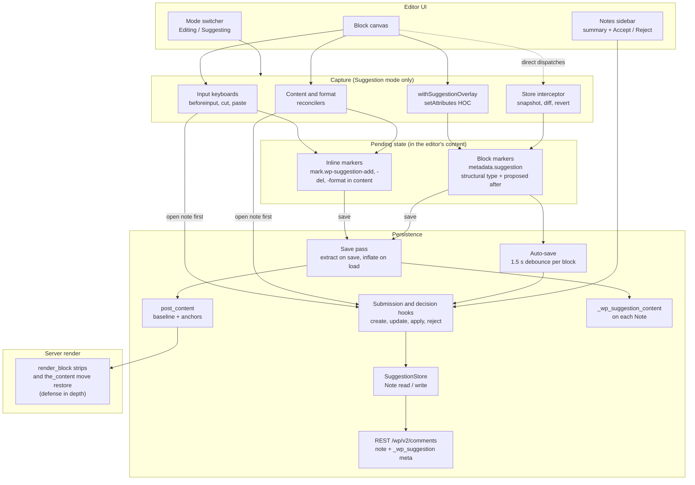
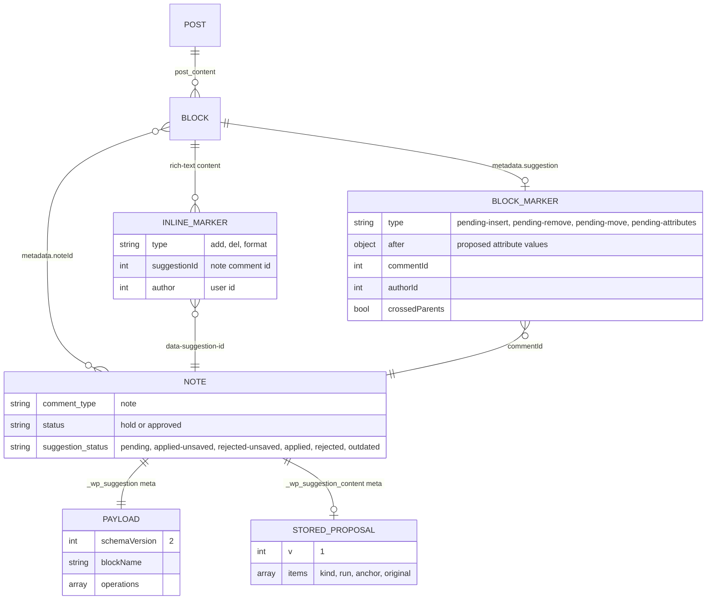
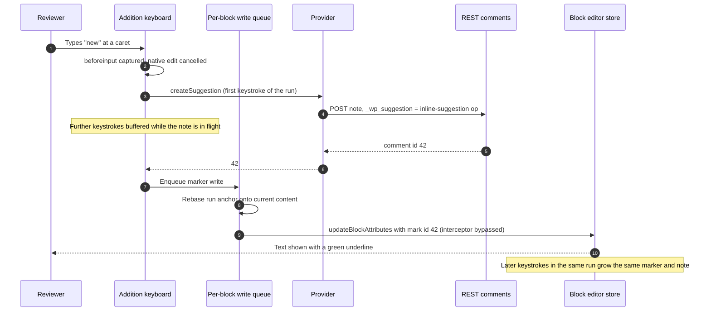
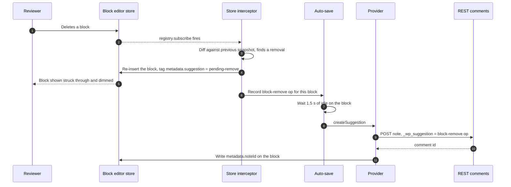
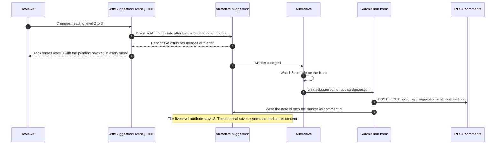
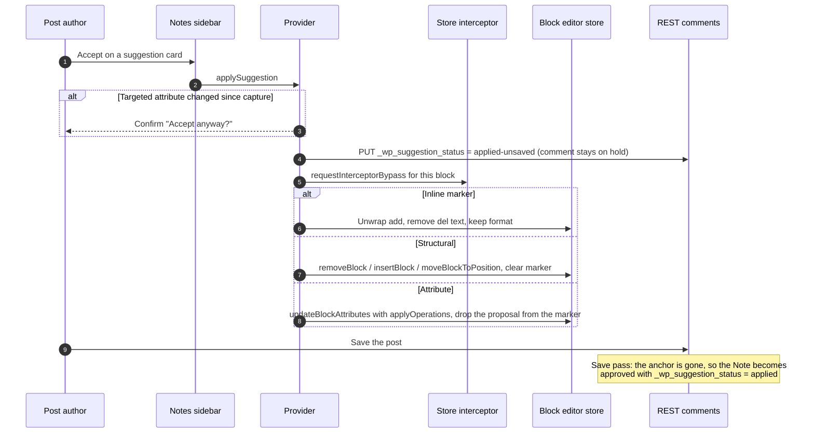
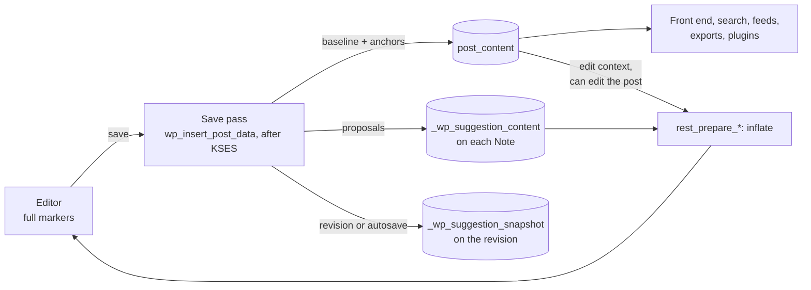

# Suggestion mode overview

This page is the map. It explains how Suggestion mode fits together: what a suggestion is, where its state lives, and how an edit travels from the keyboard to an accepted change. The detailed reference, with every payload field, rule and known limitation, is the [Suggestion mode architecture guide](/docs/explanations/architecture/suggestions.md).

Suggestion mode is an experiment. Its tracking issue is [#73411](https://github.com/WordPress/gutenberg/issues/73411).

## Short version

**A suggestion is a pending change marked in the content, linked to a Note that carries its review thread.** A reviewer switches the editor to **Suggesting** (Suggestion mode), edits normally, and every edit is captured as a suggestion instead of being applied. The post author **Accepts** or **Rejects** each one from the Notes sidebar.

**There are three kinds of suggestion, captured three ways but marked in only two shapes.** Inline changes are marks in the block's content. Structural and attribute changes are a marker in the block's `metadata.suggestion`. Either way the editor's content carries the pending state and the Note carries the review thread. When the post is saved, the server moves whatever a suggestion proposes to add out of the stored `post_content` and onto its Note, leaving a small anchor, and puts it back when the post is loaded for editing. That split is the most important thing to understand before reading the code, and [Storage at a glance](/docs/explanations/architecture/suggestions.md#storage-at-a-glance) lays out every stored key and shape on one page.

| | Inline text and formatting | Structural (insert, remove, move) | Block attributes (alignment, heading level, color) |
| --- | --- | --- | --- |
| Example | Type, delete, paste, bold a word | Delete a block, add a block, drag a block, paste a URL that becomes an Embed | Change H2 to H3, align center |
| Captured by | `beforeinput` / `cut` / plain-text `paste` "keyboards", plus a content reconciler for IME, autocorrect, drag-drop and pastes the editor transforms | Store interceptor (`registry.subscribe` diff) | `setAttributes` HOC, plus the store interceptor for direct dispatches |
| In the editor's content | A `<mark class="wp-suggestion-add">` (or `-del`, `-format`) in the block's content | `metadata.suggestion` marker on the block | The proposed values in `metadata.suggestion.after` (a `pending-attributes` marker, or `after` on a structural marker the block already has); the live attributes stay at the baseline |
| In stored `post_content` | `add`: an emptied mark. `format`: the mark around the original run. `del`: the mark and its text, unchanged | Insert: a `core/suggestion-placeholder` block. Move: the original order plus a placeholder. Remove: the block and its marker, unchanged | The marker with `after` replaced by an anchor |
| On the Note | `inline-suggestion` op, plus the proposed span in `_wp_suggestion_content` | `block-insert-after` / `block-remove` / `block-move` op, plus the suggested block or moved region | `attribute-set` op, plus the proposed values |
| Survives reload | Yes | Yes | Yes |
| Front end, search, feeds before accept | `add` text absent, `del` text shown, `format` shows the original | Pending insert absent, pending move in its original order | Unchanged: the live attributes were never touched |

**Glossary**

- **Mode** (the `editorIntent` in code): Editing or Suggesting, as in Google Docs. A session-only editor state, separate from the visual/code editor mode. Reloading always returns to Editing. A third, read-only **Viewing** mode (possibly still allowing notes) is [out of scope for the first iteration](/docs/explanations/architecture/suggestions.md#out-of-scope-viewing) and tracked in [#85770](https://github.com/WordPress/gutenberg/issues/85770).
- **Note**: a `note`-type comment (the Notes feature, GA in WordPress 6.9). A suggestion is a Note with a JSON payload in `_wp_suggestion` comment meta and a lifecycle in `_wp_suggestion_status`.
- **Marker**: the in-content record of a pending suggestion. Inline markers are rich-text formats. Block markers live in `metadata.suggestion` and are typed `pending-insert`, `pending-remove`, `pending-move` or `pending-attributes`. Both kinds carry the Note's comment id.
- **Anchor**: what the save leaves in stored `post_content` where a proposal was: an emptied mark, a marker with `after` replaced by a run number, or a `core/suggestion-placeholder` block. Each carries the Note's comment id.
- **Save pass**: the server code that runs on every post write. It moves proposals out of the content onto their Notes, and makes a decision final once a saved post no longer carries the suggestion.
- **Proposal**: the attribute values a block marker carries in `after`. In every mode the editor renders the block with the proposal merged over its live attributes, so everyone sees what is proposed. The HOC that does this is `withSuggestionOverlay`.
- **Session**: `SuggestionSessionProvider`, the in-memory coordination a suggesting tab needs (bypass tokens, handler slots, the write queue, structural capture records, the post title slot). It holds no block suggestion state.
- **Interceptor**: a data-registry subscriber that catches store changes made outside a block's own `setAttributes`, reverts them, and turns them into suggestions.

## At a glance



Every marker is content in the editor, so it syncs over RTC and replays through undo like any other edit, and the save pass decides what of it the stored post keeps. Notes are created through the submission hook, which writes them through `SuggestionStore` (the boundary a different storage backend is meant to replace, once the remaining direct reads of the comment entity move behind it), and are linked back to the block through `metadata.noteId` and the marker's id.

## Data model



The diagram shows the content as the editor holds it. [Storage at a glance](/docs/explanations/architecture/suggestions.md#storage-at-a-glance) lists what each piece becomes in the database.

Four rules hold the model together:

1. **Offsets are never stored.** An inline marker is found by id on every read (`findMarkerRange`), so unrelated edits elsewhere in the block do not break it. It is also where a CRDT-backed range lookup would plug in.
2. **Operations describe intent, not diffs.** A payload is a list of declarative ops (`attribute-set`, `block-insert-after`, `block-remove`, `block-move`, `inline-suggestion`, `post-attribute-set`). Accept replays them against the current block, and conflicts are checked per attribute.
3. **Two status axes.** The comment status (open or resolved discussion) and `_wp_suggestion_status` are independent, so a decided suggestion can keep its thread open.
4. **A decision is final only once it is saved.** Accept and Reject write a provisional status (`applied-unsaved`, `rejected-unsaved`) and change the content in the editor. The save pass writes `applied` or `rejected` when a saved post no longer carries the suggestion, and `outdated` when someone else's save removed it undecided. A client cannot write a final status.

The inline marker serializes as one class per kind:

```html
<mark class="wp-suggestion-add" data-suggestion-id="42" data-suggestion-type="add" data-author="7">new words</mark>
```

Markers of different kinds nest, so another author can suggest deleting or reformatting words inside a pending addition; rejecting the addition takes those suggestions with it, accepting it leaves them pending. Markers of one kind stack too, the Google Docs model: text typed inside someone's addition carries both additions, two people can suggest deleting the same words, and two formatting changes on the same words each keep their own delta. A character is published when every addition on it is accepted and no deletion on it is, so any order of the same decisions ends at the same text. See [Overlapping suggestions](/docs/explanations/architecture/suggestions.md#overlapping-suggestions).

Several authors can suggest on one block: the block's marker is the first suggestion, and every other author's removal or attribute proposal nests on it with its own Note, decided on its own.

## Data flow: an inline text suggestion

Typing in Suggestion mode never lets the browser edit the text directly. The keyboard cancels the native input, opens a Note, then writes the marked text.



Deletes work the same way, wrapping the removed range in a `del` marker. Type-over produces one `replace` note with a `del` and an `add` run. Bold, italic and links produce one `format` marker whose Note records what the change adds and removes as a `delta`, with the run before and after it as `beforeHTML` and `afterHTML`. Edits that arrive only as a new `content` value (IME commit, autocorrect, drag-drop) are diffed by the content reconciler into the same markers. The paste handler only takes a paste the editor would insert as exact plain text. Any paste the editor transforms (Markdown, a linked email, a URL over a selection, formatting a Code block drops) goes through the normal paste pipeline, so the result matches Editing mode, and the reconciler proposes it.

An edit inside or across someone else's marker nests in it or stacks on it. Only splitting a block inside someone's suggestion is still declined, with a notice.

## Data flow: a structural suggestion

Structural changes are caught after the fact, because they can come from many places (toolbar, keyboard, drag, List View, block switcher).



Inserts keep the new block in place and tag it `pending-insert`. Moves keep the block at its new position, tag it `pending-move` with from and to anchors, and draw a ghost at the origin. A list indent or outdent is captured as a move of the item, not as an insert plus a remove. A paste that converts to a block (a URL in an empty paragraph to an Embed, LaTeX to a Math block) is a block replacement: a `pending-remove` paragraph and a `pending-insert` block in one group.

## Data flow: a block attribute suggestion



Changes that skip `setAttributes` (for example the block switcher's variation picker dispatching `updateBlockAttributes` directly) are caught by the interceptor, reverted, and written into the same proposal. Undo withdraws a proposal like any other edit, and the Note collector trashes its Note. Redo puts the marker back, and because its Note is now in the trash, auto-save saves the returned proposal as a new Note. A marker left proposing nothing trashes its Note too. Note ids read from content are only hints: auto-save acts on one only when core-data shows it as a pending Note on this post.

## Review: accept and reject



Reject is the mirror image: drop an `add` with its text, unwrap a `del`, drop a `format` marker and recompute the run from the formatting changes still pending, undo a pending insert or move, clear a `pending-remove` marker, or drop an attribute proposal. Clearing a structural marker drops a proposal that rode on it, since one note carried both. Every accept and reject of a suggestion in block content is an ordinary undo level, so undo brings the marker back and reopens the note, and redo decides it again.

## Persistence and the front end

The editor saves full markers. The stored post must not hold text, blocks or values nobody accepted, since search, feeds, excerpts, exports and every plugin read `post_content` directly. So the server moves what a suggestion proposes out of the content on save, and puts it back when the post is loaded for editing.



What stays in the stored content depends on the suggestion:

| Suggestion | Stored `post_content` | Moved to the Note |
| --- | --- | --- |
| `add` run | the emptied mark | the mark with its text |
| `format` run | the mark around the original run | the mark around the proposed run |
| `del` run | unchanged: the text is real until accepted | nothing |
| Suggested block | a void `core/suggestion-placeholder` block | the block |
| Removed block | unchanged | nothing |
| Moved block | the original order, plus a placeholder at the proposed position | the region between the two positions |
| Attribute change | the marker with `after` replaced by an anchor | the proposed values |

Extraction and inflation are exact inverses and edit the content by byte range, so nothing outside a proposal is re-encoded. They fail closed: an anchor with nothing stored for it inflates to nothing, or to the original run for a formatting change.

The same save pass settles decisions. Accept and Reject only write a provisional status; when a saved post no longer carries a suggestion's anchor, the pass makes the decision final, and it marks another author's suggestion `outdated` when a save removed it undecided.

The render filters stay as defense in depth, for anything the save pass leaves in full form (an oversized proposal, a move it cannot restore, unbalanced markup): `render_block` drops a pending insert and `add` text, unwraps `del`, and reverts `format`, and `the_content` restores a pending move's order.

The meta registration and render filters live in `lib/compat/wordpress-7.1/block-suggestions.php`; the save pass, extraction and status rules live in `lib/compat/wordpress-7.2/`. Permissions are core's: any user who can `edit_post` on the parent can decide a suggestion. The REST controller subclass only adds payload validation (413 for oversize, 400 for invalid JSON) and allows empty note content. The full reference is [Storage at a glance](/docs/explanations/architecture/suggestions.md#storage-at-a-glance) and [Save-time extraction](/docs/explanations/architecture/suggestions.md#save-time-extraction).

## Collaboration and undo

- **RTC.** All markers, attribute proposals included, sync as ordinary content. When one peer accepts an attribute suggestion, the other peer's interceptor would see that change as drift and revert it. `isAcceptedSuggestionChange` checks the linked Notes' payloads and adopts the change instead. Locally, `requestInterceptorBypass` does the same for the accepting peer. Overlapping markers that peers write at once merge as stacked `<mark>`s; `SuggestionMarkerGuard` puts them in canonical order and drops repeated, garbled, empty or foreign markers, with one elected peer writing each correction so all peers converge.
- **Undo.** Undoing a suggestion edit removes its marker. `SuggestionNoteGC` notices the anchor is gone and trashes the Note. On redo an inline marker gets its Note restored; a redone attribute proposal is saved as a new Note (see above). Notes with replies are spared. `suggestion-undo-guard.ts` handles adoption so undo and redo do not get captured as fresh suggestions.
- **Concurrency.** Each block has a serial write queue, so the format keyboard and content reconciler cannot interleave their note-then-marker writes. A run whose surrounding text changed during the Note request is abandoned and its Note trashed.

## Further reading

- [Storage at a glance](/docs/explanations/architecture/suggestions.md#storage-at-a-glance): every stored key and shape on one page.
- [Suggestion mode architecture guide](/docs/explanations/architecture/suggestions.md): the full reference (payload schema, decision lifecycle, every known limitation).
- [#73411](https://github.com/WordPress/gutenberg/issues/73411): tracking issue and testing walkthrough.
- [#78218](https://github.com/WordPress/gutenberg/pull/78218): the Notes inline anchor the marker primitive grew from.
