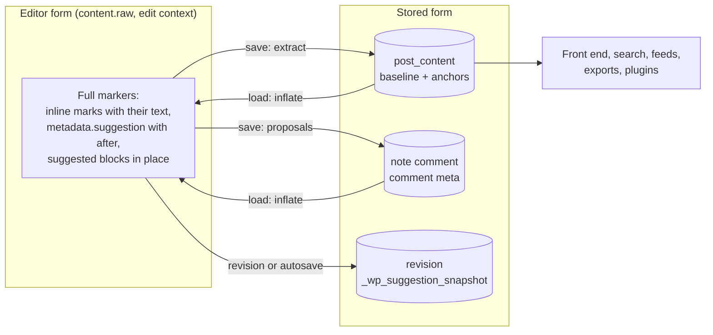
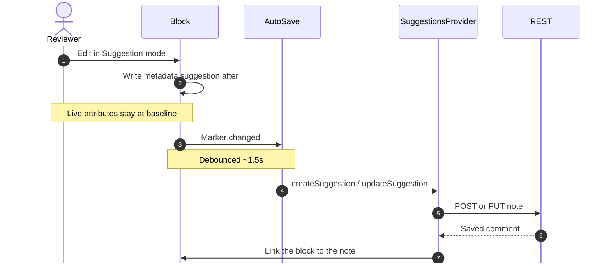
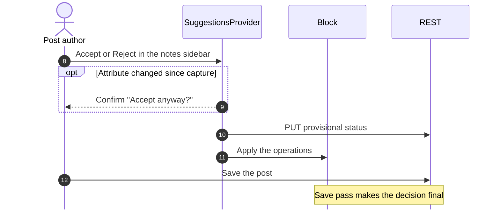
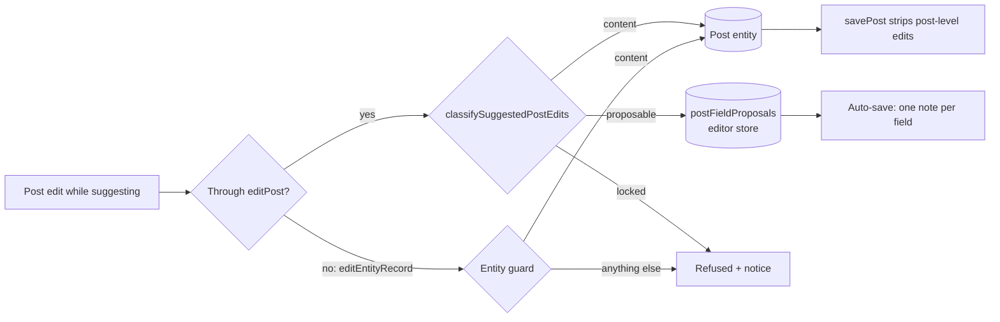
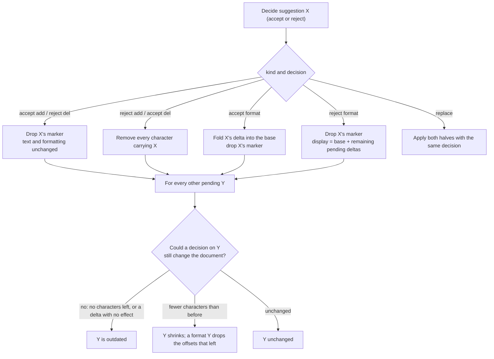
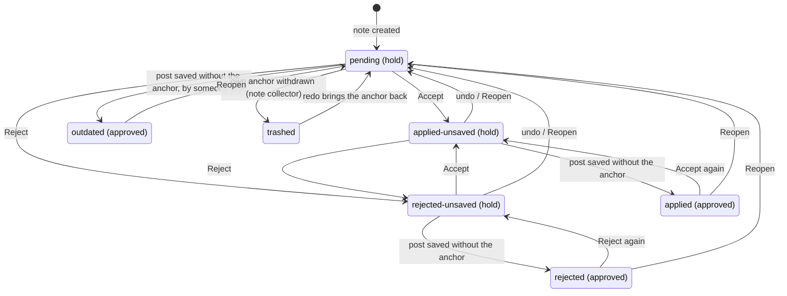
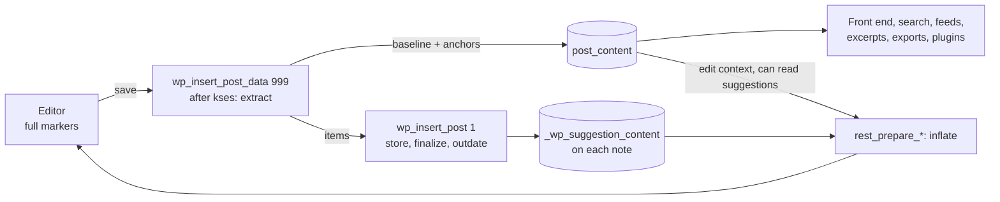

# Suggestion mode

## Overview

Suggestions extend the Notes feature (block-level comments) to support proposed content changes. A reviewer switches the editor to **Suggesting** (Suggestion mode) and edits the content; each change is captured as a suggestion linked to a note comment, and the post author then **Accepts** (merges the change) or **Rejects** (dismisses it) from the notes sidebar.

There are two complementary mechanisms, by change type:

- **Inline text and formatting changes** (typing, deleting, type-over, paste, bold/italic/link toggles, and the residual `onChange` seams - IME commits, autocorrect, drag-drop) live as anchored `<mark>` markers **in block content**, one rich-text format per kind (`core/suggestion-add`, `-del`, `-format`), re-resolved on read - edit-resilient and per-author. Markers of different kinds nest, so a deletion or formatting change can sit inside someone else's addition. See [Inline suggestion markers](#inline-suggestion-markers).
- **Non-text attribute changes** (alignment, heading level, color) and **structural changes** (insert / remove / move blocks) are recorded on the block's `metadata.suggestion` **marker** in `post_content` (a `pending-attributes` marker carries the proposed values in `after`; structural markers tag what happened to the block) and captured as versioned operation payloads on a note comment, auto-saved in the background after a short idle window. Nothing pending lives only in memory except post field proposals (the title, excerpt, featured image, slug, terms and meta), which are held in the editor store and saved as notes.

Storage sits behind a provider interface, so the comment-meta backend could later be replaced by a CRDT-native one without changing the UI or the accept and reject logic (see [Moving storage to Yjs attribution](#moving-storage-to-yjs-attribution)).

For a shorter map of the same ground, with a diagram of each data flow, see the [overview](/docs/explanations/architecture/suggestions-overview.md).

## Glossary

The terms this guide uses, in the sense it uses them.

- **Mode**: Editing or Suggesting, as in Google Docs. In code it is the `editorIntent`, so this guide says "intent" where it means the store value. See [Editor Intent](#editor-intent).
- **Note**: a `note`-type comment (the Notes feature, in WordPress since 6.9). A suggestion is a note with a JSON payload in `_wp_suggestion` comment meta and a lifecycle in `_wp_suggestion_status`.
- **Marker**: the in-content record of a pending suggestion. Inline markers are `<mark>` elements backed by rich-text formats. Block markers live in `metadata.suggestion`. Both carry the note's comment id.
- **Proposal**: the attribute values a block marker carries in `after`.
- **Anchor**: what a save leaves in the stored `post_content` where a proposal was: an emptied mark, a marker with `after` replaced by a run number, or a `core/suggestion-placeholder` block.
- **Run**: a contiguous stretch of marked text: the characters one gesture typed or deleted, or the text one marker wraps.
- **Keyboards**: the capture handlers on `beforeinput`, `cut` and `paste` that cancel a native edit and write a marker in its place (the addition, deletion and format keyboards).
- **Interceptor**: a data-registry subscriber that catches store changes made outside a block's own `setAttributes`, reverts them, and turns them into suggestions.
- **Content reconciler** (`SuggestionContentReconciler`): the client module that turns a text change arriving as a whole new value (an IME commit, autocorrect, drag-drop) into inline markers.
- **Save pass** (`Gutenberg_Suggestion_Reconciler`): the server code that runs on every post write. It moves proposals out of the content onto their notes and makes decisions final. It shares a word with the content reconciler and nothing else.
- **Note collector** (`SuggestionNoteGC`): the client module that trashes the current user's own pending note once its anchor is gone, and restores it when the anchor comes back.
- **Session** (`SuggestionSessionProvider`): the in-memory coordination a suggesting editor needs (bypass tokens, the write queue, structural capture records). It holds no suggestion state.

## Storage at a glance

Everything a suggestion persists, in one place. The sections linked from here hold the detail.

**A suggestion is a note plus an anchor.** The note (a `note` comment) holds the review thread, a description of the change, its status, and whatever the suggestion proposes to add. The stored `post_content` holds the public baseline and a small anchor that points at the note by comment id. The editor never sees that split: it loads and saves content with the full proposals in place, and the server moves them out on save and puts them back on load.



### What is stored where

| Where | Key or shape | Holds | Detail |
|---|---|---|---|
| Comment | `comment_type = note`, status `hold` or `approved` | The review thread. A note is a suggestion when it carries `_wp_suggestion`. | [Decision lifecycle](#decision-lifecycle) |
| Comment meta | `_wp_suggestion` | The payload: JSON with `schemaVersion` (2), `blockName`, `baseRevision` and a list of declarative `operations`. 64 KB cap, filtered through KSES as the user who writes it. | [Suggestion Payload (v2)](#suggestion-payload-v2) |
| Comment meta | `_wp_suggestion_status` | `pending`, `applied-unsaved`, `rejected-unsaved`, `applied`, `rejected` or `outdated`. A client writes only the first three; the save pass writes the final ones. | [Decision lifecycle](#decision-lifecycle) |
| Comment meta | `_wp_suggestion_content` | What the save pass moved out of the content for this note: `{ "v": 1, "items": [ … ] }`. Not readable or writable over REST. 1 MB cap. | [Save-time extraction](#save-time-extraction) |
| Comment meta | `_wp_suggestion_decided_by`, `_wp_suggestion_resolved_by` | The user who made the provisional decision, and the user whose save made it final. Server-written, read-only over REST. | [Decision lifecycle](#decision-lifecycle) |
| Comment meta | `_wp_suggestion_extraction_skipped` | Set when a note's proposals were too large to move out, so they stayed in the content. Read-only over REST. | [Save-time extraction](#save-time-extraction) |
| `post_content`, inline | `<mark class="wp-suggestion-add">` (also `-del`, `-format`) with `data-suggestion-id`, `data-suggestion-type` and `data-author` | One mark per suggestion, on the text it covers. Marks nest where suggestions overlap. No offsets are stored anywhere. | [Inline suggestion markers](#inline-suggestion-markers) |
| `post_content`, block | `metadata.suggestion` on the block: `{ type, after, commentId, authorId, groupId, crossedParents, nested }` | `type` is `pending-insert`, `pending-remove`, `pending-move` or `pending-attributes`. `after` holds proposed attribute values. `nested` holds other authors' suggestions on the same block. | [Structural suggestions](#structural-suggestions), [Overlapping suggestions](#overlapping-suggestions) |
| `post_content`, block | `metadata.noteId` | The Notes link from a block to its notes, shared with ordinary notes. | [Auto-save](#auto-save) |
| `post_content`, anchors | `data-suggestion-run="k"` on an emptied mark, `"run": k` in place of `after`, and a void `core/suggestion-placeholder` block | What the save pass leaves where a proposal was. `k` numbers the anchors of one note. | [Save-time extraction](#save-time-extraction) |
| Post meta, on revisions | `_wp_suggestion_snapshot` | The proposals for the anchors in a revision or autosave revision: `{ "notes": { "<note id>": { "v": 1, "items": [ … ] } } }`. Comment meta is not revisioned, so a revision carries its own copy. | [Save-time extraction](#save-time-extraction) |
| Post meta | `_crdt_document` | With real-time collaboration, the persisted Yjs document holds the content in its editor form, full markers included. Edit context only. | [Save-time extraction](#save-time-extraction) |

Post field suggestions (title, excerpt, slug, featured image, terms, meta) have no anchor in the content. Each is a note whose payload holds one `post-attribute-set` operation, and the pending value is kept in the editor store while suggesting. See [Post field suggestions](#post-field-suggestions).

### One suggestion, both forms

A reviewer suggests adding "big " to a paragraph. The editor saves:

```html
<p>Hello <mark class="wp-suggestion-add" data-suggestion-id="42" data-suggestion-type="add" data-author="7">big </mark>world</p>
```

The save pass stores this as `post_content`:

```html
<p>Hello <mark class="wp-suggestion-add" data-suggestion-id="42" data-suggestion-type="add" data-author="7" data-suggestion-run="0"></mark>world</p>
```

and this on note 42:

| Meta key | Value |
|---|---|
| `_wp_suggestion` | `{"schemaVersion":2,"blockName":"core/paragraph","baseRevision":"…","operations":[{"type":"inline-suggestion","attribute":"content","suggestionType":"add"}]}` |
| `_wp_suggestion_status` | `pending` |
| `_wp_suggestion_content` | `{"v":1,"items":[{"kind":"inline","run":0,"anchor":"<the emptied mark>","original":"<the full mark>"}]}` |

Anything that reads the post sees "Hello world". An edit-context REST response for a user who can edit the post gets the first form back in `content.raw`.

An inline deletion or a removed block leaves nothing on the note: text and blocks proposed for removal stay in the content, because they are real until someone accepts. [Save-time extraction](#save-time-extraction) has the table of what every kind of suggestion leaves in the stored content and on the note.

### Life of the stored data

1. **Create.** An inline suggestion creates the note first (`POST /wp/v2/comments` with `_wp_suggestion`) and then writes the mark into the content with the new comment id. A block-level suggestion writes the `metadata.suggestion` marker first; auto-save creates the note after about 1.5 s of idle time and writes its id back onto the marker as `commentId`. Either way, the id on the marker is the id of the note.
2. **Save.** `Gutenberg_Suggestion_Reconciler` runs on every post write: it moves proposals out of the incoming content after KSES (`wp_insert_post_data`), stores them on their notes, and compares the anchors before and after the write (`wp_insert_post`).
3. **Load.** `rest_prepare_{post_type}`, `rest_prepare_autosave` and `rest_prepare_revision` put the proposals back into `content.raw` for a user who passes `gutenberg_can_read_suggestions()`.
4. **Render.** The stored content is already the baseline. The `render_block` and `the_content` filters stay as defense in depth for anything the save pass left in full form.
5. **Decide.** Accept or Reject writes a provisional status to the note, then changes the content in the editor. The next post save, by anyone, sees the anchor gone and writes the final status and drops `_wp_suggestion_content`.
6. **Outdate.** A save that removes another author's undecided anchor marks that note `outdated`.

### Versions and limits

| Format | Version | When it is unknown or invalid |
|---|---|---|
| `_wp_suggestion` payload | `schemaVersion: 2` | An older payload is migrated forward on read. A newer one is refused, with only Reject offered. See [Schema versioning](#schema-versioning). |
| `_wp_suggestion_content` items | `v: 1` | Any other version reads as nothing stored, so its anchors inflate fail-closed. |
| Inline marks | none: the class token is the format | A `<mark>` without a known class is not a suggestion. An unbalanced one fails closed at render. |
| `metadata.suggestion` | none: `type` is the discriminator | A marker with an unknown `type`, or an `after` that is not an object, is treated as absent. |

Notes are linked by comment id, which an import renumbers. A WXR export therefore leaves `_wp_suggestion_content` and `_wp_suggestion_snapshot` out and carries the baseline content with its anchors. With Gutenberg deactivated, the anchors render nothing: an emptied mark has no content, and the placeholder block is unknown.

### Where the code is

| Concern | File |
|---|---|
| Meta registration, payload sanitizing, size caps, render filters | `lib/compat/wordpress-7.1/block-suggestions.php` |
| Extraction and its inverse | `lib/compat/wordpress-7.2/class-gutenberg-suggestion-content.php` |
| The save pass hooks, status changes, revision snapshots, re-inflation | `lib/compat/wordpress-7.2/class-gutenberg-suggestion-reconciler.php` |
| Every anchor shape, read from serialized content | `gutenberg_get_suggestion_anchor_index()` in `lib/compat/wordpress-7.2/suggestion-reconciliation.php` |
| Status rules over REST | `lib/compat/wordpress-7.2/suggestion-status.php` |
| The block marker | `packages/editor/src/components/suggestion-mode/marker.ts` |
| The payload and its operations | `packages/editor/src/components/suggestion-mode/operations/` |
| The inline mark formats | `packages/editor/src/components/inline-suggestions/format.ts` |
| Note reads and writes | `packages/editor/src/components/suggestion-mode/suggestion-store.ts` |
| Tests that pin the stored bytes | `phpunit/tests/suggestion-content-round-trip-test.php`, `suggestion-content-save-test.php`, `suggestion-reconciliation-test.php` |

Each module of the editor code is listed in the [`suggestion-mode` README](https://github.com/WordPress/gutenberg/blob/trunk/packages/editor/src/components/suggestion-mode/README.md).

### PHP files

The REST and PHP surface lives in `lib/compat/wordpress-7.1/` and `lib/compat/wordpress-7.2/` (marked 7.2 below). Notes themselves (the `note` comment type, `_wp_note_status` and `editor.notes` post-type support) are core since WordPress 6.9.

| File | Role |
|------|------|
| `suggestion-status.php` (7.2) | Provisional and final status lists, `_wp_suggestion_decided_by` stamping, and the REST refusal of final statuses. |
| `class-gutenberg-suggestion-reconciler.php`, `suggestion-reconciliation.php` (7.2) | The save pass, the edit-context re-inflation, `gutenberg_can_read_suggestions()`, the `core/suggestion-placeholder` block, and `gutenberg_get_suggestion_anchor_index()`, the one place that reads suggestion anchors from serialized content. |
| `class-gutenberg-suggestion-content.php` (7.2) | `Gutenberg_Suggestion_Content`: extraction of proposals into anchors plus items, and its exact inverse, re-inflation. |
| `class-gutenberg-suggestion-block-scanner.php`, `class-gutenberg-suggestion-marker-processor.php` (7.2) | Block delimiters with byte offsets (driving `WP_Block_Processor` from WordPress 7.2 and `WP_Block_Parser::next_token()` before it, whichever that version's `parse_blocks()` uses), and the Tag Processor that exposes token spans to the marker walk. |
| `block-suggestions.php` | `gutenberg_register_suggestion_meta` registers `_wp_suggestion` (sanitized, 64 KB cap, KSES on proposed values, plain text for a structural op's `excerpt`) and `_wp_suggestion_status`, each with an `edit_post`-on-parent `auth_callback`, plus the read-only provenance meta and the private storage of the save pass (`_wp_suggestion_content`, `_wp_suggestion_snapshot`, both kept out of WXR exports). Also the render side: `gutenberg_strip_inline_suggestion_markers`, the kind-aware `render_block` strip for inline markers (`del` keeps text, `add` drops text, `format` reverts per character to the recorded original), which reads markers through `gutenberg_get_suggestion_marker_kind()`, and `gutenberg_strip_pending_structural_suggestions`, its structural counterpart (`pending-insert` blocks dropped, `pending-remove`/`pending-move` blocks kept). `gutenberg_restore_pending_move_order` runs earlier, on `the_content` ahead of `do_blocks()`, and restores the pre-move sibling order of any list holding a single pending move, so an un-accepted move does not change published output. |
| `block-suggestions.php` (validation) | `gutenberg_validate_suggestion_post_operations` (on `rest_preprocess_comment`) refuses, with a 400, a note whose `post-attribute-set` op targets anything but the title, excerpt, featured image, slug, one of the post type's REST taxonomies, or a meta key registered with `show_in_rest` that the suggester could edit (`gutenberg_can_suggest_post_meta`, `edit_post_meta`). |
| `block-suggestions.php` (attribute validation) | `gutenberg_validate_suggestion_attribute_operations` (on `rest_preprocess_comment`) refuses, with a 400, a note whose `attribute-set` op proposes a value the accept-time check would refuse, as far as the server can judge it, and `gutenberg_guard_suggestion_attribute_operations_meta` refuses the same payload written outside REST. See the write-time checks under [Accept / Reject](#accept--reject). |
| `class-gutenberg-rest-comment-controller-7-1.php` | Thin subclass of the comments controller (it extends `Gutenberg_REST_Comment_Controller_7_2`, which keeps note reactions working). Permissions stay core's. It adds only storage rules: `prepare_item_for_database` rejects an oversized `_wp_suggestion` with 413 and an invalid JSON payload with 400, and `check_is_comment_content_allowed` lets a note carrying a suggestion payload have empty content. `create_item` stores a new top-level suggestion note as `hold` when the request sets no status. |

## End-to-end lifecycle

A suggestion has two halves: a reviewer's edit becomes a note, and later the post author decides on it. The first diagram follows a block attribute suggestion, where the marker is written first and its note follows. An inline suggestion runs in the other order: the note is created on the first keystroke and the mark is written once the comment id is known (see [Inline suggestion markers](#inline-suggestion-markers)).

### 1. Capture: an edit becomes a note



1. The reviewer switches to Suggestion mode and edits a block.
2. `setAttributes` is redirected: the proposal lands in `metadata.suggestion.after` and the live attributes stay at the baseline. Inline edits land as marks in the content, structural edits as pending markers.
3. The marker change schedules the debounced auto-save.
4. Auto-save calls `createSuggestion` for a new marker, `updateSuggestion` for one that already has a note.
5. The provider writes the note and its `_wp_suggestion` meta to `/wp/v2/comments`.
6. REST returns the saved comment.
7. On create, the comment id is written in two places: into the block's `metadata.noteId` list and onto the marker as `commentId` (see [Auto-save](#auto-save)).

### 2. Decide: the author accepts or rejects



8. The post author opens the notes sidebar and chooses Accept or Reject.
9. If the targeted attribute changed since the suggestion was captured, a confirm dialog asks whether to apply it anyway.
10. The provider keeps the note on `hold` and sets `_wp_suggestion_status` to `applied-unsaved` (or `rejected-unsaved`).
11. `updateBlockAttributes( applyOperations( ... ) )` changes the block and removes the marker.
12. The author saves the post. The save pass sees that the anchor is gone and makes the decision final: comment status `approved`, `_wp_suggestion_status` `applied` (or `rejected`). See [Decision lifecycle](#decision-lifecycle).

## Editor Intent

A session-scoped `editorIntent` state (orthogonal to the visual/code `editorMode` preference) controls the editing purpose:

| Intent    | Behaviour |
|-----------|-----------|
| `edit`    | Default - direct editing. |
| `suggest` | Attribute edits are written as a proposal on the block's `metadata.suggestion` marker and never change the live attributes; inline text and structural edits are written as pending markers too (see below). Post-level fields are proposed or locked (see [Post field suggestions](#post-field-suggestions)). |

The intent lives in the `core/editor` store's reducer (not the preferences store), so reloading the editor always returns to `edit`. It also belongs to the post it was chosen on: the store remembers that post, and `getEditorIntent` reports `edit` on any other entity (a template opened from the post, another post) and `suggest` again once the editor returns to it. Choosing Editing anywhere forgets it. Also, `setEditorIntent( 'suggest' )` is refused without the experiment and on a post type that does not support notes. It is surfaced as an **Editing / Suggesting** menu (the Google Docs names) in the editor's "Options" kebab, gated behind the `editor.notes` post-type support flag; the `setEditorIntent` / `getEditorIntent` store APIs are private while Suggestion mode is experimental.

### Out of scope: Viewing

Google Docs has a third mode, **Viewing**: a read-only editor in which the content cannot be changed. It is deliberately left out of the first iteration so the work can focus on Suggestion mode, and is tracked as a follow-up in [#85770](https://github.com/WordPress/gutenberg/issues/85770). There is no `view` intent, no third menu item and no shortcut for it.

Viewing is a separate feature and not a variant of suggesting. It needs its own read-only guards (on the canvas, `editPost`, undo and redo, and the code editor), and it has an open design question of its own: whether a viewer can still leave notes, which would make it a comment-only mode and not a strictly read-only one. Nothing in the suggestion storage or capture design depends on the answer. The intent is a plain string in the `core/editor` store, so a third value can be added later without changing the two that exist.

### Feature gating

Suggestion mode is an experiment, and three things decide where it runs.

- **The experiment.** `gutenberg-suggestion-mode` on the Experiments screen. PHP sets `window.__experimentalSuggestionMode` before any editor script runs, and `isSuggestionModeEnabled()` (`suggestion-mode/gate.ts`) reads it.
- **Post type support.** A suggestion is a note, so the post type must declare `editor.notes` support. `useCanSuggest()` combines the experiment and this check, and gates the Mode menu, the shortcuts and the provider wiring. `gutenberg_suggestions_enabled( $post )` is the same test on the server. The note thread list is requested only for such a post type (`hasNotesSupport`), so an entity opened from a post, a synced pattern for one, sends no notes request for the server to refuse.
- **The server is gated on the experiment too.** With it off, REST refuses a write of `_wp_suggestion` or `_wp_suggestion_status` (`rest_suggestions_unavailable`, 403), and the save pass neither extracts, finalizes nor re-inflates.
- **The render filters are not gated.** They run whenever Gutenberg is active, so a proposal that a post's content still carries in full is never shown to visitors, whatever the experiment says.

Turning the experiment off on a site that has used it leaves each post as the save pass stored it: the public baseline plus anchors, with the proposals on their notes. The editor then loads that stored content. The marker formats stay registered, so an emptied anchor survives a load and a save and its suggestion can be reviewed once the experiment is back on; rich text only round-trips an emptied `<mark>` while its format is registered. An anchor the user deletes while the experiment is off takes its suggestion with it: no pass sees the removal, so the note stays pending with nothing to apply and can only be rejected once the experiment returns. A notice explains the anchors (`use-suggestion-review-notice.ts`), the notes sidebar lists the suggestions without Accept, Reject or Reopen, and the code editor is not withheld, since nothing could resolve the markers that withhold it.

The Mode menu and its shortcuts live in `@wordpress/editor`, with no code in `edit-post`, `edit-site` or the `routes/` entry points, so the feature is not specific to the post editor: it follows the post type's `editor.notes` support.

## Capture

While the editor is suggesting, every edit is captured as a suggestion and nothing reaches the live content unmarked. An edit can arrive in four ways, and each has its own capture path:

| Edit | Captured by | Becomes |
|---|---|---|
| A block attribute changed through `setAttributes` | The `withSuggestionOverlay` HOC | A proposal in `metadata.suggestion.after` |
| An attribute or tree change dispatched straight to the store | The store interceptor | A proposal, or a structural marker |
| Text and inline formatting | The keyboards, plus the format keyboard and content reconciler for changes that arrive as a whole new value | Inline marks in the content |
| A post field (title, excerpt, terms and so on) | `editPost` and the entity guard | A proposal in the editor store, or a refusal |

Block-level markers are saved as notes afterwards by [Auto-save](#auto-save). An inline suggestion opens its note first and writes its mark once the note has an id.

### Block attribute suggestions

When the intent is `suggest`, an `editor.BlockEdit` filter (`withSuggestionOverlay`) wraps every block's `Edit` component:

1. **Proposal** - `setAttributes` writes the changed values into the block's `metadata.suggestion.after` (a `pending-attributes` marker, or the `after` of a structural marker the block already carries) as a normal persistent change, through the block-editor store. On a block carrying another author's marker, the edit goes into the author's own entry in that marker's `nested` list instead (see [Overlapping suggestions](#overlapping-suggestions)). Keys whose value equals the live value are dropped; a marker left proposing nothing is removed. An edit built from the stored attributes is the exception: the block support panels (Typography, Color, Dimensions) read the stored attributes and write every attribute they manage, so the ones the author left alone arrive at their stored value. `rebaseEditOntoProposal()` (`marker.ts`) recognizes such an edit by its being closer to the stored attributes than to the shown ones, drops the values it leaves as stored and makes its change to an object value (`style`) on the proposed one, so a font size picked after a text color keeps the color. An edit that sets nothing but stored values is still a withdrawal.
2. **Baseline untouched** - the live attributes never change. The marker is JSON in `post_content`, so the proposal survives a reload, syncs to peers, and sits on the undo stack: Ctrl+Z withdraws it and the note collector trashes its note. The front end renders the baseline with no PHP involvement, since `metadata` never reaches front-end markup.
3. **Merge for render** - in every intent, a block with a proposal receives `{ ...liveAttributes, ...after }`, with every nested proposal's `after` merged in note id order, so the suggester, the author and reviewers all see what is proposed, exactly as they see a pending removal or an inline mark. The merge happens in the `editor.BlockListBlock` filter below, because block supports (font size, colors, duotone, alignment) build the block wrapper from the attributes `BlockListBlock` receives, not from what `Edit` renders. The `BlockEdit` filter reads the live attributes from the store, so edits are still diffed against the baseline.

A companion `editor.BlockListBlock` filter tags each block with a pending change so it is discoverable without relying on the selected-block toolbar. A proposal gets an `is-suggestion-pending` class (a solid outline in the author's color); pending structural changes get `is-suggestion-pending-remove` (red strikethrough), `is-suggestion-pending-insert` (green dashed outline), or `is-suggestion-pending-move` (dotted outline and a "Suggested move" tab), mapped from the block's `metadata.suggestion` marker. The outlines use a block-level note's 1.5px rule, with no offset or radius. When the suggester's user id is known, `getAvatarBorderColor` resolves their avatar color and it rides on the block wrapper as an inline `style="--suggestion-author-color: …"`, so two suggesters' pending treatments are distinguishable at a glance. A suggestion's note never gets the notes highlight's block overlay (`buildBlockHighlightCss` skips threads carrying `_wp_suggestion`): the suggestion's own marker, inline or on the block, is the only one.

### Store interceptor

The HOC only catches edits that flow through a block's own `setAttributes` prop. Some Gutenberg paths bypass the prop chain and dispatch `updateBlockAttributes` directly to the block-editor store - most notably the block-switcher's variation picker (e.g. swapping a heading from H2 → H3). Those mutations would otherwise land in the post unchanged, defeating Suggestion mode.

`SuggestionStoreInterceptor` is a companion subscriber that closes that gap:

1. On Suggest activation it snapshots every block's attributes. Only the post's own blocks are captured from there on (see [Blocks the post does not own](#blocks-the-post-does-not-own)).
2. It subscribes to the data registry. On every store update it diffs the live attributes against the snapshot.
3. For drift on a tracked block it writes the changed attributes into the block's marker proposal (`metadata.suggestion.after`) and dispatches a revert that restores the snapshot. A reentrancy gate (`isDispatchingOwnWrite`) suppresses the synchronous subscribe fire the revert itself triggers, while per-revert identity tokens (`createRevertGuard`, in `attribute-suggestions/revert-guard.ts`) recognize revert echoes that arrive later - a batched or deferred dispatch - by matching the exact restored values instead of swallowing everything inside a time window.
4. Structural mutations (a block inserted, removed, or moved) are captured too - see [Structural suggestions](#structural-suggestions) below.
5. System-managed metadata (`metadata.noteId` written by the suggestion provider after creating a note comment) is folded into the snapshot before diffing so it's invisible to the diff and never leaks into a proposal.

The interceptor uses `registry.subscribe` rather than a React `useSelect` because (a) it must run synchronously after each dispatch, before any re-render serializes the now-wrong state, and (b) `subscribe` also catches dispatches from non-React paths.

### Blocks the post does not own

A suggestion is a note on the current post, and the save pass and the review UI only find a marker stored in that post's content. The canvas also holds blocks saved elsewhere: the children of a block with controlled inner blocks (a synced pattern in `wp_block`, a template part in `wp_template_part`, a navigation menu in `wp_navigation`), and, with the template shown, the template itself around Post Content. `createPostOwnershipCheck()` (`suggestion-mode/block-ownership.ts`) answers which is which from the block-editor store: a block belongs to whatever holds its nearest ancestor with controlled inner blocks (`areInnerBlocksControlled`), so a synced pattern block placed in the post is the post's and its children are the pattern's. With no such ancestor the block is in the root tree, which is the post's unless the rendering mode is `template-locked`; in that mode only what the first Post Content block holds is the post's.

Every capture seam asks it:

- The store interceptor adopts a change to a block the post does not own as its new baseline: no marker, no revert, no structural capture. This also covers the blocks a controlled block loads or reloads, which arrive with new client ids.
- The overlay HOC declines a `setAttributes` call on such a block, and the keyboards cancel typing, deleting, pasting, cutting, Enter, Backspace and Delete in its rich text, each with the notice "This block is saved outside this post, so it can't be changed while suggesting." This matches how an edit to a site setting is refused while suggesting. A block preview (the Template panel's, a pattern list's) is a block editor of its own with nothing of the post's in it: the HOC passes its blocks through (`isPreviewMode`), so a previewed block that writes an attribute as it loads is not refused.
- The content and format handlers refuse a request for such a block.

See [Known Limitations](#known-limitations) for what this does not cover.

### Structural suggestions

Inserting, removing, and moving blocks are captured as suggestions, not applied to the post. The interceptor follows the same "keep the store at baseline" principle as attribute edits - it **reverts the structural mutation and tags the block** with a `metadata.suggestion` marker, so the canvas keeps showing blocks at their baseline positions with a pending treatment until the change is accepted or rejected:

| User action | Interceptor response | Persisted op | Reject undoes by |
|-------------|----------------------|--------------|------------------|
| Delete a block | Re-inserts the subtree from the previous-tick snapshot at its prior parent + index, tags it `pending-remove`. A block with a pending move goes back to the move's origin first: the removal replaces the move | `block-remove` (carries an `excerpt` of the block's text) | clearing the marker (the block stays) |
| Insert a block | Leaves the new block in place, tags it `pending-insert` (it has no baseline to revert to). An empty default block is deferred: it gets no marker until something is put into it, and a save made while suggesting leaves it out of the content (`serializeWithoutDeferredInsertions`), so it never reaches the post as a plain block nobody can decide on | `block-insert-after` (with `anchorClientId` / `parentClientId`) | dispatching `removeBlock` |
| Move a block | Leaves it at the proposed position, tags it `pending-move` with the from/to anchors, and renders a non-interactive ghost at the origin | `block-move` (`from*` / `to*` anchor + index fields) | dispatching `moveBlockToPosition` back |
| Change an attribute | Writes the proposal to the block's marker (`pending-attributes`, or `after` on an existing structural marker) | `attribute-set` (rides along after any structural op) | clearing the proposal |

The marker's shape:

```ts
interface SuggestionMarker {
	type: 'pending-attributes' | 'pending-remove' | 'pending-insert' | 'pending-move';
	/** Proposed attribute values. JSON-safe; permitted on every type. */
	after?: Record< string, unknown >;
	/** Filled by auto-save once the note exists. */
	commentId?: number;
	authorId?: number | null;
	groupId?: string;
	crossedParents?: boolean;
	// pending-move: fromAnchorClientId, fromParentClientId, fromIndex, fromParentBlock
}
```

`after` never contains `metadata.suggestion` or `metadata.noteId`. A marker whose `after` is not a plain object, or whose `type` is unknown, is treated as absent by every reader (`readSuggestionMarker`).

The interceptor records each structural op it captured on the session (`recordStructuralCapture`) so auto-save persists it as its own note (attribute-set ops ride along in the same payload, but the structural op leads); a marker with no capture in this session (it came in with the post) is derived from the marker and the live tree. Accept dispatches the real block-editor action (`removeBlock` / `insertBlock` / `moveBlockToPosition`); both Accept and Reject finish by clearing the structural marker via `clearSuggestionMarkerAttributes`, which drops a proposal that rode on it: one note carried the structural op and the attribute ops, so its decision resolves both. Other authors' nested suggestions stay, the first taking the marker's place. (Undoing the structural change while suggesting is different: the undo guard keeps the proposal as its own `pending-attributes` marker.)

Suggestions one gesture produced on several blocks share a `groupId`, on their markers and in their payloads, and one decision settles them all (`findGroupPartners`, read from the live markers so it survives a reload). A `replaceBlocks` (a block transform, Group, a paste over a selection) is a removal plus an insertion in one parent. A deletion from inside one block to inside a later one is a proposal on the first block, which takes the end of the last, plus the removal of every block after it: accepting the removals without the proposal would lose that text. The card of each says it is part of one block change.

Same-parent move attribution is selection-first: an adjacent swap is ambiguous to order-diffing alone ("B moved up" and "A moved down" produce identical orders), so the detector prefers the reading in which the currently selected blocks are the movers - the block a user moves via the toolbar, keyboard, or drag stays selected - and falls back to a longest-common-subsequence heuristic when the selection doesn't explain the reorder. This keeps a nudged block's marker (and its single note) on the block the user acted on, however many hops they make. Rejecting a pending move batches the marker-clear and the restoring `moveBlockToPosition` into one store update; the interceptor recognizes that shape (marker present in the previous tick, gone from the live block) as the suggestion landing rather than a fresh move to re-capture - the same shape a remote reject arrives in through sync.

Indenting or outdenting a list item creates or empties a nested list in the same update as the move. A new block whose children all existed and left a parent of the same type (an indent's nested list) is a carrier, not an insertion: it gets no marker, and each item it carries is captured as a cross-parent `pending-move`. A removed block whose children are all live in a parent of the same type (an outdent's emptied nested list) goes with the move instead of becoming a `pending-remove`, and the move records where it sat as `fromParentBlock`. Rejecting the move rebuilds that list there, copying the type and attributes of the list the item sits in now (never the note payload, which the suggester writes), or removes the nested list the item leaves empty. Any other removal re-inserts its subtree without the descendants that are still live elsewhere, so a moved block is never duplicated.

A structural suggestion changes the tree itself: its pending state (the `metadata.suggestion` markers, and the suggested blocks themselves) lives in the real block tree and is saved with the content, the structural counterpart of inline markers living in content. That is what lets a pending move, removal or insertion, and its link to a note, survive a reload. On save, the server moves the proposal out of the stored `post_content` onto the note and puts it back for editors on load (see [Save-time extraction](#save-time-extraction)).

### Inline text and formatting changes

Inline **text** changes - typing, deleting (character, word, or line), type-over, cut, and single-line paste - do **not** become attribute proposals. They live as marked text directly in block content, anchored to the #78218 inline-`<mark>` marker primitive. This is the edit-resilient model requested in [#73411](https://github.com/WordPress/gutenberg/issues/73411): a suggestion is "this anchored range is proposed for deletion / this inserted run is proposed for addition", re-resolved against current content on read, rather than a whole-attribute before/after snapshot. It also makes concurrent per-author inline suggestions on one block work for free, dissolving [#79220](https://github.com/WordPress/gutenberg/issues/79220).

Inline **formatting** changes (bold / italic / link toggled over a run, the text unchanged) are markers too: the reformatted run is wrapped in a single `format`-type marker carrying the *proposed* formatting - the Google Docs model, the text shown once and never duplicated into a paired del/ins diff. The `withSuggestionOverlay` HOC's `setAttributes` seam detects the format-only diff (`planFormatMarkers`) and hands it to the singleton `SuggestionFormatKeyboard`, which opens the note (recording what the change adds and removes as a `delta`, and the run before and after it as `beforeHTML` / `afterHTML`) and writes the marker.

Text edits that reach a block as a whole new `content` value with no interceptable input event - a committed IME composition, autocorrect (`insertReplacementText`), drag-drop - are diffed into markers by the singleton content reconciler (`SuggestionContentReconciler`): the HOC plans the edit against the previous value (`planEditMarkers`) and, when every planned action opens a fresh note, the reconciler executes it. Both singletons serialize their note-then-marker writes per block through a shared write queue and re-validate the live content around the async note POST, abandoning (and trashing the note of) a plan the content has moved past.

The marker itself, its decoration and how it is decided are described under [Inline suggestion markers](#inline-suggestion-markers). The attribute proposal path handles what's left: **non-text attribute** suggestions (alignment, heading level, color) and inline edits the marker planners decline (an edit straddling an existing marker, a format toggle overlapping one). Values written into a proposal are stripped of live suggestion markers first (`stripSuggestionMarkers`) and stored JSON-safe (a `RichTextData` as its string), so accepting an attribute suggestion later can never replay (and resurrect) a marker whose suggestion was resolved in the interim. A proposal never renders inline content diffs.

#### Edit-driven creation

In Suggestion mode every edit is a suggestion, so there are no toolbar buttons - the act of editing produces the marker. Two `beforeinput`-capture keyboards own the input-event paths (plus `paste`/`cut`-capture handlers), cancelling the native edit and writing the marker instead; two singleton `onChange`-side components (the format keyboard and the content reconciler) own edits that surface only as a fresh `content` value. All of them key the marker to a freshly created `note` comment and bypass the store interceptor so the marker lands in content:

| User action | Result |
|-------------|--------|
| Select text + Delete/Backspace | `del` marker over the selection |
| Backspace / Delete at a caret | `del` marker on the adjacent grapheme; repeating in one direction grows a single marker |
| Word / line delete (`deleteWordBackward`, `deleteHardLineForward`, …) | `del` marker over the exact range the delete would remove (`computeDeleteRange`) |
| Cut (Cmd/Ctrl+X) | `del` marker over the selection; the cut run is written to the clipboard as both `text/plain` and `text/html` |
| Type at a caret | `add` marker; contiguous typing grows one marker (the whole span is re-stamped so it stays a single `<mark>`) |
| Type over a selection | one `replace` note: an `add` run for the new text followed by a `del` run over the replaced text, both carrying the note's id |
| Single-line plain-text paste | `add` marker (handled on the `paste` event, ahead of the editor's paste pipeline), but only when the pipeline would insert the exact plain text |
| Single-line paste the editor transforms | left to the editor's paste pipeline so the result matches Editing mode, then proposed like any other edit: Markdown and auto-linked emails become an `add` marker carrying the formatting, a Code, Preformatted or Verse block drops the formatting, an http(s) URL over a selection becomes a `format` marker for the link (an `add` marker with the link at a caret), and a paste that converts to a block (a URL in an empty paragraph to an Embed, LaTeX to a Math block) is a block replacement: `pending-remove` paragraph plus `pending-insert` block in one group. |
| Bold / italic / link toggle | single `format` marker wrapping the reformatted run (via `SuggestionFormatKeyboard`) |
| IME commit, autocorrect, drag-drop | diffed into `add`/`del` markers by `SuggestionContentReconciler` |
| Enter inside a block (split) | the head gets a `del` marker over the base text that moved to the new block, which becomes a `pending-insert` block. The author's own `add` text in the moved run leaves the head outright (its note is collected once no marker anchors it) and arrives in the new block as plain text. Markers the new block inherits are settled the way the front end renders them (`del` and `format` unwrapped, the author's own `add` unwrapped, another author's `add` dropped with its text), and it keeps no note link that another block holds. A split whose moved run carries any other marker (another author's, or the author's own `del` or `format`) is declined with the generic notice. |
| Multi-line paste | the paste pipeline commits the merged value to the block-editor store directly (not through `setAttributes`), so the store interceptor captures it as a whole-attribute proposal - never a raw commit, never an inline diff. Converting this capture into inline markers is a possible follow-up. |

The first keystroke of a run opens the note asynchronously; keystrokes during that window are buffered (typing) or counted (deletion) while the caret stays where the run started, and applied when the comment id resolves. When the note request fails because the server could not be reached (`offline_error`, `fetch_error`), the run is kept, with whatever is typed into it meanwhile, and the note is asked for again when the browser reports the connection back or five seconds later, until it is saved, the text around the run changes or Suggestion mode is left. One notice says the suggestion will be added on reconnect; a failure the server answered with drops the run as before. Every failure to save a suggestion shares one notice id, so repeating a gesture replaces the snackbar.

Typed text takes the formats active at the caret, as it does outside Suggestion mode: those of the run it is typed into, or ones turned on first (Bold, then typing). That state lives in the selected rich text and the addition keyboard writes the text itself, so the marker formats' `edit` publishes it (`caret-formats.ts`) for the keyboard to read. After each write the `edit` puts the active formats back, since rich text drops them when content and selection are set from outside, which would end a bold run after its first character. Accepting an addition gives a format it shares with the text around it one identity again, so text typed into a bold run does not split the `<strong>`.

The deferred write is anchored to the block's content, not to the caret: each run records its offsets and the attribute's text when it starts (`rebaseRunAnchor` in `run-anchor.ts`), so clicking another block, pressing Enter, or typing elsewhere during the round trip still writes the run's marker in its own block, at its own offsets (shifted past any edit that landed before them). The caret follows the marker only when the user is still at the run. The run is dropped, and its note trashed, only when the text around its anchor changed or Suggestion mode was left.

An edit whose range overlaps an existing suggestion marker is checked against the overlap matrix (`classifyOverlap`, see [Overlapping suggestions](#overlapping-suggestions)): another author's markers nest or stack, and only a gesture that reaches the author's own `add` or `del` is left to the own-marker paths below. The exception is a type-over that touches the author's own pending `add` marker (`reviseOwnAddition`): a selection wholly inside it revises the addition in place (same marker, same note), and a selection that also covers plain original text on one side turns that text into a `del` run under the same note, which becomes a replacement.

Deleting a selection that crosses only the author's own `add` and `del` markers (`deleteAcrossOwnMarkers`) removes the additions, keeps the deletions, and marks any original text left between them as one new deletion. That includes a selection of a block's whole text, which rich text removes on `keydown` rather than through `beforeinput`, so the deletion keyboard takes that keystroke first.

### Post field suggestions

Post-level fields are not blocks, so nothing in the content can carry a marker for them. Suggestion mode never lets one change the saved post while suggesting: each field is either **proposed** or **locked**.



**Proposed fields** are the title, excerpt, featured image (`featured_media`), slug, the terms of each of the post type's taxonomies (by `rest_base`), and each post meta key the post's REST record carries (only keys registered with `show_in_rest`). `editPost` sorts its edits with the pure `classifySuggestedPostEdits` (`store/suggest-post-edits.ts`): content (`blocks`, `content`, `selection`, and the content-derived `footnotes` meta) passes through, a proposable change is held in the editor store's `postFieldProposals` (keyed by field, or `meta.<key>`, with the value the field had when first proposed as its `baseline`), and anything else is refused.

While suggesting, the public `getEditedPostAttribute` selector returns a field's proposed value (its docblock says so), so every panel and plugin that reads the post through the editor store shows the proposal with no code of its own. Code that needs the value the post will be saved with reads the `core` entity record (`getEditedEntityRecord`), or the private `getPostFieldValueWithoutProposals`. A meta proposal is merged into `meta`; a terms proposal returns term ids only (see new terms below).

The auto-saver saves each proposal as its own note holding one `post-attribute-set` op (`{ attribute, key?, before, after }`) with no block anchor; the sidebar names the field ("Post title", "Excerpt", "Featured image", "Categories", "Post meta: key") instead of treating the note as an orphan, the summary quotes text fields, lists added and removed terms, and shows thumbnails for the featured image.

Accept applies the op with the private `applyPostFieldSuggestion`, which writes past the guard (rolled back if the decision fails to save); Reject only records the decision and drops the proposal. Undo withdraws the newest proposal when it is newer than every block capture, putting the field back at its baseline so the auto-saver trashes the note.

Proposals live in memory, so a reload empties them while their notes stay pending. When the post's notes load, `useHydratePostFieldProposals` restores a proposal from each of the current user's pending post-level notes (the note's `before` is the baseline), linked to the note by `commentId`. The field shows the proposal again while suggesting, editing it updates that note rather than opening a second one, and editing it back to the baseline trashes the note, as undo does. Undo after such a re-edit returns to the value the note holds (`noteValue`) rather than withdrawing a suggestion made in an earlier session. Other authors' notes are never restored: the current user's edit to the same field opens a note of their own, and a decision on someone else's note does not clear the user's own proposal for that field.

**New terms** can be proposed from the term pickers. Creating a term is a real write to the taxonomy, so a suggestion never creates one: a new term rides on the terms proposal as a `{ name, parent? }` entry beside the term ids (`[ 12, { name: 'Jazz', parent: 4 } ]`), the pickers show it like a proposed existing term (a chip, a checked checkbox) through the private `getProposedNewTerms`, and the note summary reads "New tag: Jazz". `getEditedPostAttribute` leaves the entries out, so readers only ever see term ids. Accept creates each new term as the reviewer (`createProposedTerms`), through the normal term REST permissions, reusing a term with the same name that appeared meanwhile, then assigns it; when the reviewer may not create terms in the taxonomy the accept fails with the REST error as a notice and the note stays pending. Reject writes nothing. The server validates each entry when the note is saved: a term id, or a new term with a sanitized, non-empty name and a parent only for a hierarchical taxonomy, as one of its terms. The suggester needs no capability to create terms, since nothing is created.

**Locked fields** are everything else: status, author, date, password and visibility, sticky, comment and ping status, format, parent, template and menu order. Moving the post to the trash is locked too, and so are the site settings the post editor shows (the template summary's blog title, posts per page and discussion default): none of them is a change to the post a reviewer could accept. Their sidebar controls are read-only while suggesting, with the reason as their description, and the post actions menu leaves out Trash, the delete actions and the homepage and posts page actions. Three seams refuse them whatever path a write takes:

- `editPost` refuses a call that changes a locked field (status keeps its own message; every other field shares "This setting can't be changed while suggesting."), dropping the whole call so a companion edit cannot land without it. Content in the same call still passes.
- `installSuggestPostEditGuard` (`store/suggest-post-edit-guard.ts`) wraps the core-data `editEntityRecord` action on the actions object `useDispatch` and thunks share, so a direct write to the current post (`useEntityProp`, a plugin, the console) is refused too. It refuses an edit of the site entity or the posts page outright, a `saveEntityRecord` or `saveEditedEntityRecord` of the site entity (so a site setting staged in Editing is not saved from Suggesting), and a `deleteEntityRecord` of the current post; `trashPost` refuses itself. A plugin's meta field that writes through `useEntityProp` is therefore refused, not proposed; one that writes through `editPost` is proposed. The wrap is installed for the editor's lifetime from the provider's first render and checks the intent per call, so a component that destructured the action before the intent changed is still covered. Editors in sub-registries share that actions object, and a call does not say which editor made it, so it is wrapped once and every mounted editor is asked on each call: a post is guarded while its own editor is suggesting, the site settings while any editor is, and the originals come back when the last editor unmounts.
- `savePost` strips every post-level edit from a save made while suggesting, after the `editor.preSavePost` filter. An edit staged in Editing before switching to Suggesting stays on the entity, unsaved, and is saved as usual back in Editing.

The server validates every `post-attribute-set` op before a note is stored (see [PHP files](#php-files)), so a reviewer's accept can only ever write a field Suggestion mode proposes, and a meta key the suggester was allowed to edit; the reviewer's save checks the reviewer's own capabilities again.

### Auto-save

There is no manual "Submit" step: `SuggestionAutoSave` watches the blocks that carry a `metadata.suggestion` marker and, after ~1.5 s of idle time on a given block, persists the operations derived from the marker and the live tree as a note comment (`operationsFromMarker` for the proposal, the interceptor's recorded capture or `structuralOpFromMarker` for the structural op). The note id is written back onto the marker as `commentId`, and the hook keeps a fingerprint of the last synced operations per block, so subsequent edits update the same note rather than creating new ones. A marker left proposing nothing trashes the note; a marker that disappears is the note collector's business. Ids read from content are only hints: auto-save updates or trashes a note on their account only when core-data shows it as a pending note on this post that the current user wrote. Authorship read from content is a hint too. Auto-save saves only a marker whose `authorId` is the current user's, so a marker with no `authorId` is nobody's and is never saved as a note, and nothing is saved until the current user has resolved. The submission hook checks the same thing before it rewrites or trashes any note for the suggester: the note must be a `note` on this post written by the current user, whatever a marker's `data-author` or `authorId` claims.

A save that fails is retried up to three times, five seconds apart, and a marker change schedules a fresh save. Saves still waiting out their debounce are sent when the page is hidden (`visibilitychange`, `pagehide`), when Suggestion mode is left and on unmount, so closing the tab inside the idle window does not leave a marker without a note. That is best effort: a browser may drop a request started while the page unloads.

A block is linked to a suggestion's note twice. `metadata.noteId` is the Notes link, shared with ordinary notes: the list of every note on the block, kept in step by the submission hook outside undo history. The marker's `commentId` says which of those notes the marker belongs to, since one block can carry several notes and several nested markers. The `commentId` write-back is best-effort, so a marker without one (the write was lost, or the editor was reloaded first) is matched through `metadata.noteId` to the block's pending note of the same shape, and a second note is never opened.

An inline suggestion is found by neither link. Its `<mark>` travels with the text, so Accept and Reject locate it by the marker's id across the block tree (`findInlineMarker()` in `anchor-index.ts`), trying the linked block and the attribute the payload names first. A merge that carries the marked text into another block, or a transform that drops `metadata.noteId` or renames the attribute, leaves the suggestion decidable. The anchor index reads inline anchors the same way, from every rich-text attribute of every block, as the server does.

The inline keyboards only handle a rich-text field whose key is one of the block type's attributes. A field with any other identifier, such as a table cell (`body.0.cells.0.content`), is left to the block's own `onChange`, and the edit becomes an attribute suggestion on the block.

## Inline suggestion markers

Inline text suggestions are built on a shared, format-agnostic marker primitive in `packages/editor/src/components/inline-markers/`, generalized from the #78218 Notes anchor (`findMarkerRange`, `wrapInlineMarker`, `readInlineSelection`, `readInlineCaret`, `reconcileMarkerRemoval`, `useAnnotateRanges`). Notes and Suggestions both consume it; each passes its own format type, id attribute, and annotation source so the two coexist on one block.

### The marker

A suggested inline change serializes as

```html
<mark class="wp-suggestion-add" data-suggestion-id="N" data-suggestion-type="add" data-author="A">…</mark>
```

with one class token, and one rich-text format, per kind:

| Kind | Format | Class | What the run is |
|------|--------|-------|-----------------|
| `add` | `core/suggestion-add` | `wp-suggestion-add` | proposed new text |
| `del` | `core/suggestion-del` | `wp-suggestion-del` | existing text proposed for removal |
| `format` | `core/suggestion-format` | `wp-suggestion-format` | existing text whose formatting change is proposed: the run carries the proposed formatting, the note's `delta` records what it adds and removes and its `beforeHTML` the run below it |

`data-suggestion-id` is the linked note's comment id and `data-author` tags the suggester. The class is authoritative; `data-suggestion-type` is written alongside it for styling and the screen-reader decoration. Every check of a marker's kind goes through the helpers in `inline-suggestions/format.ts` (`isSuggestionFormat`, `suggestionKindOf`, `suggestionMarkersAt`), the store keeps its own copy of the class tokens (`SUGGESTION_MARKER_CLASSES`), and PHP reads markers through `gutenberg_get_suggestion_marker_kind()`. Content carrying an earlier single `core/suggestion` format and its `wp-suggestion` class is not migrated (the feature is an experiment): those parse as plain `<mark>`s. **Offsets are never stored** - `findMarkerRange` re-scans the rich-text `formats` array for the marker by id on every read, so a marker survives unrelated edits elsewhere in the same attribute. This is the only place offsets are resolved, and where a CRDT-backed range lookup would plug in.

### Decoration

`SuggestionAnnotations` re-derives each pending marker's live range (`findSuggestionRange`) and decorates it through the annotations API at runtime - nothing is written back to content. The annotations API keeps one decoration per character, so ranges are applied widest first and the selected thread last: an addition stays highlighted around the suggestions nested in it.

`content-suggestion.scss` draws markers in the inline note's vernacular: a 25% tint behind the run and a 1.5px rule mixed with 30% `currentColor` for contrast. Additions and deletions are green and red, tint and rule alike, whoever suggested them, so they read apart from notes at a glance; a `format` marker is tinted with its author's color. The rule is keyed off each marker's class (`del` → red strikethrough, `add` → green underline, `format` → dotted underline in the author's color marking the already-visible proposed formatting as provisional; a `format` nested in an `add` drops its dotted line below the addition's solid one, and an `add` nested in another `add` drops its underline lower, its tint stacking on the outer one's), so the kind reads from the line's style as well as its color.

`SuggestionAuthorColors` injects one `:is(.wp-suggestion-add, .wp-suggestion-del, .wp-suggestion-format)[data-author="N"]{--suggestion-author-color:…}` rule per author, which the `format` tint reads. Text decorations propagate, so a deletion inside an addition shows both lines, and two deletions of the same text keep one line-through.

Each marker in a nested stack gets its own screen-reader decoration, read outer start, inner start, text, inner end, outer end, up to the innermost three (`SUGGESTION_A11Y_MAX_ANNOUNCED`): the outermost of those adds "N more suggestions on this text". The redundant per-thread annotation highlight is neutralized for suggestion markers.

### Selection

The marker formats' `edit` (`collab-sidebar/suggestion-format-edit.tsx`, passed in at registration by the editor provider and registered on every kind) mirrors `NoteFormat` for inline notes: while a notes sidebar is open, the caret inside a marker selects that marker's note (where markers nest, the innermost: a deletion over a formatting change over an addition, so the several active instances agree), so a block holding several suggestions points at the one under the caret rather than the block's primary note. Both halves of a replacement carry one id and resolve to one note. Moving the caret from a marker to plain text in the same block deselects that note if it is still selected; a pending sidebar focus request is left alone, and leaving the block stays with the block-level sync. `RevealSelectedSuggestion` thickens the selected note's marker rule to 3px, as a selected note's marker does, so the marker under the caret stands out too. A new suggestion leaves the open sidebar alone: its note shows in the floating notes beside the block, like a new note.

### Accepting and rejecting a marker

Resolved by id and kind against the live marker range: accept `del` removes text + marker; reject `del` drops the marker (text stays); accept `add` unwraps the marker (text becomes permanent); reject `add` removes text + marker; accept `format` folds its delta into the characters' base and drops the marker; reject `format` drops the marker and recomputes each character as its base plus the deltas still pending, keeping every other marker on it (see the formatting deltas in [Overlapping suggestions](#overlapping-suggestions)). Each decision removes its own id's marker only, so accepting an addition leaves the deletions and formatting changes nested in it pending. The inline op records only which attribute carries the marker, the marker kind, and (for `format`) the delta and the before/after run HTML - the range is always re-derived. Removal-type resolutions delete only the characters actually carrying the marker's id, so another suggestion's marker interleaved inside a fragmented run survives. What a decision does to the other suggestions is described next.

## Overlapping suggestions

Suggestions overlap the way they do in Google Docs, whose API documents the model: a run of text carries a list of insertion ids, a list of deletion ids, and one formatting delta per suggestion id. Here each suggestion is its own marker element, and a character carries every marker on it. The example from [#73411](https://github.com/WordPress/gutenberg/issues/73411) is the case it serves: Anne suggests adding a sentence, Bob types words inside it, Carl suggests bolding some of them, and Dana and Erin both suggest deleting the same words.

### Stacked markers

Each kind is its own rich-text format, and a character may carry several markers of one kind, one per suggestion, told apart by id. Nested same-class `<mark>`s parse into a stack of formats on each character and serialize back as nested elements, so `@wordpress/rich-text` needs no change. Its `applyFormat`, `removeFormat` and `toggleFormat` keep one format per type and would flatten a stack, so marker writes go through `addSuggestionMarker`, `removeSuggestionMarker` and `removeAllSuggestionMarkers` (`inline-suggestions/format.ts`), and a `no-restricted-imports` rule in `tools/eslint/config.mjs` forbids the three rich-text helpers in `inline-suggestions/` and `inline-markers/`. Membership is the only primitive: a suggestion is the set of characters whose stack holds its id, which need not be contiguous. `suggestionMarkerListsAt()` returns a character's markers per kind, outermost first; `suggestionMarkersAt()` returns only the outermost marker of each kind.

### Canonical nesting

Every marker write ends in `canonicalizeSuggestionStack()`, which orders each character's stack `add`, then `format`, then `del`, then content formats, orders markers of one kind by id with the oldest (lowest) outermost, and drops a repeated kind and id. Adjacent characters share one object per marker. The same state therefore always serializes to the same bytes (stable round trips and RTC merges), and a `format` marker is never split by a nested deletion:

```html
Intro.<mark class="wp-suggestion-add" data-suggestion-id="12" …> Bright <mark class="wp-suggestion-add" data-suggestion-id="15" …><mark class="wp-suggestion-format" …><strong>red </strong><mark class="wp-suggestion-del" data-suggestion-id="17" …><mark class="wp-suggestion-del" data-suggestion-id="18" …><strong>apples</strong></mark></mark></mark></mark> fell.</mark>
```

Rich text writes `class` after the other attributes, so hand-written markup comes back reordered on its first round trip and is stable after that. A marker split by another marker becomes adjacent elements with the same id.

### What may overlap

`classifyOverlap()` (`inline-suggestions/overlap.ts`) is the matrix every editing path asks: the keyboards, the format planner, the content reconciler. Every gesture by another author is allowed:

| Gesture | Someone's `add` | Someone's `del` | Someone's `format` |
| --- | --- | --- | --- |
| Type at a caret inside the run | a nested `add`: the typed text carries their marker and yours | an `add` between the two halves of their deletion | an `add` |
| Delete inside, or across the run and plain text | a nested (or spanning) `del` | a second `del` on the same words | a `del` inside it |
| Format inside the run | a nested `format` | a `format` around it | a second `format` stacked on it, with its own delta |
| Format across the run's edge | one `format`, partly inside the addition | one `format` | one `format`, stacked where the two overlap |
| Type over a selection | the `del` half nests; the `add` half nests if the caret is inside the addition | the `del` half adds a second deletion; the `add` half sits beside it | a replacement next to it |

Gestures over the author's own markers keep their own paths: growing or revising an addition and deleting across their own markers. Formatting is not one of them: formatting their own proposed text opens a `format` suggestion nested in the addition, as it would in anyone else's, so a reviewer decides the text and its formatting apart. A second format on those words revises that suggestion (`findExtendableFormatMarker` in `reconcile-format.ts` looks past the author's own older addition around the run). Taking back your own addition also removes other authors' markers nested in it. Two edits are still declined, with one generic notice (`notifyEditRefused` in `refuse-edit.ts`): splitting a block where the moved text carries another author's marker (or the author's own `del` or `format`), and an edit that would hide a marker under a whole-attribute proposal.

### Formatting deltas

A `format` note records what its suggestion changes, per character, as a `delta`: runs of `{ offset, length, added, removed }`, where `offset` counts the characters carrying the suggestion's marker and `added` / `removed` list rich-text formats (`{ type, attributes? }`). The displayed formatting of a character is its base plus every pending delta on it, applied in id order. The base is never stored: it is the display with the pending deltas reverted in reverse id order (`format-delta.ts`). Each delta is kept effective, describing only what it changes on top of the state below it, and a decision rebuilds the affected characters from the base and re-derives every remaining delta, so the outcome follows id order, never decision order. `beforeHTML` (the run as it is below the change) and `afterHTML` stay on the note: the summary reads them, the editor rewrites `beforeHTML` after every decision, and the render strip restores from it. A note written before deltas existed gets its delta derived from `beforeHTML` on load (`formatDeltaFromOriginal`).

### Resolution

One rule covers every combination, with no parent/child graph to keep: a character is published when every addition on it is accepted and no deletion on it is accepted, and its formatting is the base plus every accepted delta, applied in id order. `resolveInlineSuggestion()` (`inline-suggestions/resolution.ts`) applies one decision and reports the suggestions it shrank or emptied:



Each step only drops ids from characters or removes characters, so decisions commute: any order of the same decisions ends at the same text, with the same suggestions outdated. Rejecting Anne's addition takes Bob's, Carl's, Dana's and Erin's suggestions with it; accepting it leaves them pending as ordinary suggestions; accepting Bob's addition and then rejecting Anne's removes Bob's words too, since they only existed inside hers; accepting either deletion of the shared words removes them and outdates the other where nothing of it is left. A formatting change left with nothing to change (one that removed bold another change added, once that one is rejected) loses its marker and is reported emptied. The decision hook (`use-suggestion-decisions.ts`) announces the suggestions a reject emptied. It does not touch their notes: the note collector trashes only the current user's own orphaned notes, and the save pass marks another author's note `outdated`. Undo brings the text and every nested marker back.

### Sidebar context

`suggestionRelations()` derives, from the markers, every addition a suggestion sits inside (oldest first), the others' suggestions it holds, other authors' deletions of the same text, and the formatting change it builds on, and the note shows them: "Inside a suggested addition by Anne", "Inside suggested additions by Anne, Bob", "Includes 2 suggestions from others", "Partly inside a suggested addition by Anne", "Dana also suggested deleting this text", "Built on a suggested formatting change by Carl". While an addition holding others' suggestions is pending, a consequence line under it says "Rejecting also makes 2 suggestions outdated." There is no confirmation step.

### Testing overlaps

One set of JSON fixtures drives every layer, so a combination is written once and checked everywhere. A fixture describes a base text, the users and each suggestion. An oracle derives from it the published text for any set of decisions, the suggestions those decisions outdate, and the accept and reject orders to check. Vitest replays the orders through the real operations, PHPUnit renders each generated state through the render strip and compares it with the oracle, and Playwright seeds a fixture over REST and drives the orders through the sidebar. How to run, replay and regenerate them is in the [test README](https://github.com/WordPress/gutenberg/blob/trunk/packages/editor/src/components/inline-suggestions/test/README.md).

### Block-level overlaps

A block has one `metadata.suggestion` marker, the outermost suggestion on it. Other authors' suggestions on the same block sit in its `nested` list, one entry per author, each a `pending-attributes` or `pending-remove` marker with its own `commentId`, `authorId` and `after` (`marker.ts`). A marker belongs to the user its `authorId` names. One with no `authorId` belongs to no known user: another user's edit nests beside it and does not fold into it. They are entries rather than a map keyed by note id because a new proposal has no note id until auto-save opens its note. What the block shows is every proposal's `after` merged in note id order (`displayedProposal()`), unsaved ones last, so where two proposals set one attribute the later one wins.

| Another author… | On A's `pending-insert` block | On A's `pending-attributes` | On A's `pending-move` |
| --- | --- | --- | --- |
| Removes the block | a `pending-remove` nests on A's insertion | a `pending-remove` nests on A's proposal | the removal nests; A's move stays the block's marker |
| Changes an attribute | a proposal nests on A's insertion | a second proposal nests, with its own note | a proposal nests |
| Moves the block | only where A's block is proposed changes; A's note follows it | the move takes the outer place and A's proposal nests under it | declined: "Someone else has already suggested moving this block." (see Known Limitations) |

Each nested suggestion is decided on its own. Accepting a nested removal removes the block; accepting a nested proposal lands it and leaves the block's other suggestions pending; rejecting one drops only that entry. Deciding the block's own marker lifts the first nested entry into its place (`withoutMarkerEntry()`). A proposal a decision left with nothing to change (every key now equals the live value) is dropped from the block (`withoutOutdatedProposals()`); its note becomes `outdated` on save, or is collected when it is the current user's. The sidebar shows who else suggested what on the block ("Anne also suggested removing this block", "Bob also suggested changes to this block", "Anne suggested adding this block"), and on a suggested block that rejecting it also outdates what others suggested on it. On the server, the save pass moves each nested entry's `after` onto its own note and the anchor index anchors each entry by its own note, falling back to the block's `metadata.noteId` links for an entry saved before it had one. Post field proposals keep one note per field per author; when an accepted one is saved, the save pass marks `outdated` every other author's pending proposal whose values the post now already holds, and leaves one that still changes the field pending.

## Suggestion Payload (v2)

Stored as a JSON string in the `_wp_suggestion` comment meta on a `note` comment:

```json
{
  "schemaVersion": 2,
  "blockName": "core/paragraph",
  "baseRevision": "2026-04-15T12:34:56",
  "operations": [
    {
      "type": "attribute-set",
      "attribute": "content",
      "before": "Hello world",
      "after": "Hello beautiful world"
    }
  ]
}
```

| Field | Purpose |
|-------|---------|
| `schemaVersion` | Allows future schema evolution without breaking old payloads. |
| `blockName` | Safety check: accept refuses to apply `attribute-set` values to a block of another type. See [Accept / Reject](#accept--reject). |
| `baseRevision` | `post_modified_gmt` at capture time, kept for provenance only. Accept-time conflicts are detected per attribute; see **Conflict detection** below. |
| `operations` | Declarative transforms on the block tree or the post. v1 emitted `attribute-set` only; v2 adds the structural variants (`block-insert-after`, `block-remove`, `block-move`, tracked in [#77434](https://github.com/WordPress/gutenberg/issues/77434)), `inline-suggestion` and `post-attribute-set`. |

Operations are **declarative transforms**, not HTML diffs. This makes them compatible with Yjs attribution semantics and resilient to concurrent edits on unrelated attributes.

A payload carries at most one structural op, because the auto-save loop persists each structural mutation as its own note; `attribute-set` ops may ride along, but the structural op leads. An inline note carries a single `inline-suggestion` op that names the attribute and the marker kind; the range is never stored. The op types and their distinguishing fields:

| `type` | Fields beyond `type` / `blockName` | Accept dispatches |
|--------|------------------------------------|------------------|
| `attribute-set`     | `attribute`, `before`, `after`, `groupId` when grouped with other blocks' suggestions | `updateBlockAttributes` |
| `inline-suggestion` | `attribute`, `suggestionType` (`add` / `del` / `replace` / `format`), plus `delta`, `beforeHTML` and `afterHTML` for `format` | the marker operations in `inline-suggestions/operations.ts`, against the range found by id |
| `block-remove`      | `parentBlockName`, `excerpt`, `groupId` when grouped (half of a replacement, or removed by a deletion across blocks) | `removeBlock` |
| `block-insert-after`| `anchorClientId`, `parentClientId`, `parentBlockName`, `excerpt`, `groupId` for half of a replacement | none: the block is already in place, so accept clears its marker |
| `block-move`        | `fromAnchorClientId` / `fromParentClientId` / `fromIndex`, `toAnchorClientId` / `toParentClientId` | `moveBlockToPosition` |
| `post-attribute-set`| `attribute`, `before`, `after` | `editPost` |

A structural op does not carry its block. The block stays in the content under its marker, which is what accept and reject act on, so the payload only needs to name it: `blockName`, and `excerpt`, the start of the block's text as plain text on one line, cut to 120 characters (`BLOCK_EXCERPT_MAX_CHARS`, the length the summary quotes) and left out for a block with no text. The size of the block therefore does not count against the payload cap. Payloads written before `excerpt` carry the whole block as `block`; it is still accepted and filtered, and is read only for its text, after the live block and the excerpt (`structuralOperationText`). The shape change needs no `schemaVersion` bump: a reader that does not know `excerpt` ignores it and shows the bare block label once the block is gone. An insertion's `excerpt` is written when the note is created, on the first keystroke, so it is refreshed from the block as the suggestion is decided. An inline op records its marker's text the same way, as `decidedText` (and `decidedDeletedText`, the replaced text of a replacement), cut to 1000 characters: the text lives only in the marker, which a decision removes. The summary reads the live marker or block first and falls back to these.

### v1 → v2 compatibility

The shape of a v1 payload is a strict subset of v2 (only `attribute-set` operations). v1 payloads are migrated forward in `parseSuggestionPayload` by stamping `schemaVersion: 2` - no rewriting needed. The bump matters because a v1 reader that encountered a v2 payload with structural ops would silently drop them at apply time; refusing the payload outright surfaces an explicit "newer editor" notice and offers only Reject.

### Schema versioning

`schemaVersion` is incremented whenever the payload shape changes. Consumers apply the following rule:

| Parsed version vs. consumer's known version | Behavior |
|---|---|
| `parsed < known` | Migrate the payload forward to the current shape before applying. Migrations are additive: missing fields are filled with defaults. |
| `parsed === known` | Apply normally. |
| `parsed > known` | Refuse to apply - show a "this suggestion was made by a newer editor" notice and offer only Reject. |

When bumping the version, add a migration step in `parseSuggestionPayload` that lifts `parsed.schemaVersion < SCHEMA_VERSION` payloads into the current shape. Ship the bump and the migration in the same PR; do not read unknown future payloads.

## Provider Interface

```text
useSuggestionsProvider() → {
  createSuggestion({ clientId, blockName, operations })  → Promise<comment>
  updateSuggestion({ commentId, blockName, operations }) → Promise<comment>
  deleteSuggestion({ commentId })                        → Promise<void>
  applySuggestion({ commentId, clientId, payload })      → Promise<void>
  rejectSuggestion({ commentId, clientId, payload })     → Promise<void>
}
```

The current implementation keeps the note writes of the submission and decision hooks in `SuggestionStore` (`suggestion-store.ts`), which uses comment meta. It is not yet the only way to a note: the note collector, the format keyboard and the marker guard write the comment entity directly, and about thirty reads of `_wp_suggestion` across the editor package take the comment record as it is. A CRDT-backed implementation would have to move those behind the store before it could replace it (see [Moving storage to Yjs attribution](#moving-storage-to-yjs-attribution)).

## Accept / Reject

Every decision first writes a **provisional** status to the note (`applied-unsaved` or `rejected-unsaved`, comment kept `hold`), and only then changes the content. A failed status write leaves the editor untouched; a content change that fails puts the note back to `pending`. The decision becomes final when the post is saved (see [Decision lifecycle](#decision-lifecycle)).

- **Accept** (attribute ops): runs `applyOperations(currentAttributes, payload.operations)` to produce new attributes and dispatches `updateBlockAttributes`. A `metadata` op holds only the keys it changes (a block name, a binding) and is merged into the block's metadata; every other attribute is replaced.
- **Accept-time checks** (attribute ops): the suggester wrote the values and the reviewer's save stores them, possibly with capabilities the suggester lacks, so `getAttributeApplyRefusal` (`apply-refusal.ts`) runs before the provisional status is written and again as the values land. A refused accept changes nothing, shows a notice and leaves the note pending; nothing is dropped or repaired to make the rest apply. It refuses when:
    - the note's proposal is no longer on the block, or the payload does not propose what the block's marker proposes (`proposalMatchesOperations`). The canvas shows the marker and accept applies the payload, and separate requests write them. The payload stays the applied copy because it is the one filtered with its author's capabilities;
    - the payload's `blockName` is not the target block's type;
    - an operation names an attribute the registered block type does not declare (block.json attributes plus the ones block supports add), or a value that does not match the attribute's `type` or `enum` (`findAttributeOperationProblem`, `operations/validate.ts`);
    - a value would serialize as something a filtered author could not have saved: a `tagName` with no `enum` outside a list of sectioning and grouping elements, a URL with a protocol outside `wp_allowed_protocols()` defaults (the check format deltas use, `operations/url-scheme.ts`), a `style` string that leaves its declaration (for a URL in a style: a quote, an escape, a control character, or `;`, `{`, `}`, `<`, `>`), custom CSS (`style.css`) the block does not already have, or a `metadata` op naming `noteId` or `suggestion`.
- **Write-time checks** (attribute ops): the server applies the same value rules when the note is written (`gutenberg_find_suggestion_attribute_operation_problem`), so a note it stores does not depend on the client that later reviews it. Over REST an invalid `attribute-set` operation refuses the request with a 400 (`rest_invalid_suggestion`); a write made any other way is refused and the stored payload stays as it was. Like accept, it drops and repairs nothing. The payload is judged twice: as sent, and as KSES leaves it for storage (`gutenberg_find_suggestion_attribute_write_problem`), since removing markup or a null byte can join the halves of a protocol or of `url(`. The stored copy has its entities decoded first and skips `type`, `enum` and the custom CSS rule, which filtering only blurs. KSES filters the keys of a proposed value too, and the rules read a value by its keys (`css`, a URL key), so a payload whose keys differ once filtered is refused, as is one PHP cannot read as objects (a key that starts with a null byte). The server knows less than the editor, so it applies what it can judge:
    - the URL protocol, `style` string and `metadata` rules read no schema, so they hold for every block. The protocol list is the site's `wp_allowed_protocols()`, which a filter can change, where the editor has the defaults;
    - `type`, `enum` and the `tagName` list apply to an attribute the block type declares on the server, which includes the attributes block supports register. A block type registered only in JavaScript, or an attribute a plugin adds with a `blocks.registerBlockType` filter, has no schema there, so an undeclared attribute is stored and left to the accept-time check;
    - custom CSS (`style.css`) cannot be compared with the editor's live block, and the operation's `before` is the suggester's own claim, so it is not read. A user with `edit_css` may propose any custom CSS. Anyone else may only carry along, with the rest of the `style`, custom CSS the saved post already holds for a block of that type at the same position (`gutenberg_get_suggestion_post_block_custom_css`): the top of the `style`, or under the same state keys (`:hover`, `@mobile`). Content saved without `edit_css` has its custom CSS stripped from exactly those positions, so what the post holds there was written by someone allowed to; a `css` key anywhere else is not read. The match is by block type, not by block, since a new note is not linked from the content yet. Custom CSS that exists only in an unsaved editor is refused until the post is saved. Accept still refuses custom CSS the block does not already have, whoever proposed it.
- **Accept-time checks** (post ops): `getPostApplyRefusal` holds a `post-attribute-set` payload to the fields `isProposablePostField` allows, and to each field's value shape, before a term is created or the post is edited. The REST route applies the same list when a note is written; this is the check on the side that edits the post.
- **Accept** (structural ops, `planStructuralApply`): `block-remove` clears the marker and runs `removeBlock` in one batched store update. A `block-insert-after` or `block-move` block is already where it was proposed, so Accept applies the payload's attribute operations to it and clears the `metadata.suggestion` marker via `clearSuggestionMarkerAttributes`.
- **Reject**: clears any `metadata.suggestion` marker. For structural suggestions it also undoes the in-canvas pending state: `block-insert-after` runs `removeBlock`, `block-move` runs `moveBlockToPosition` back to the original spot, `block-remove` simply drops the marker (the block was never actually removed). An attribute reject drops the proposal from the marker (`clearProposedAttributes`), and rejecting a suggestion nested on another author's marker removes only its own `nested` entry; neither changes the live attributes.
- **Undo**: every decision on block content is an ordinary undo level, attribute rejects and nested rejects included, so undo brings the marker back and reopens the note, and redo decides it again. Only the bookkeeping around a suggestion stays out of history: the note id written back onto the block, the cleanup of an abandoned note, and the undo guard's withdrawals.
- **Conflict detection**: accept-time staleness is checked at the attribute level, not the post level. `hasAttributeConflict(currentAttributes, operations)` compares each operation's captured `before` to the block's current value; only a real divergence on a targeted attribute prompts the "apply anyway" confirmation. (`block-insert-after` is exempt - its baseline is `{}`, so a comparison against the already-typed-into block would always read as divergence.) Post-level `baseRevision` is still stamped into the payload for provenance, but does not drive the prompt - every auto-save bumps `post_modified_gmt`, so a post-level compare would flag nearly every suggestion as stale.

## Decision lifecycle

A decision is content: Accept and Reject change the post, and the change only exists once the post is saved. `_wp_suggestion_status` records where a note is on that path, and only the server writes a final value.

| `_wp_suggestion_status` | Comment status | Meaning | Written by |
|---|---|---|---|
| absent / `pending` | `hold` | Awaiting a decision | Client (create, reopen); the server holds a new suggestion note created with no status |
| `applied-unsaved` | `hold` | Accepted in an editor that has not saved the post | Client |
| `rejected-unsaved` | `hold` | Rejected in an editor that has not saved the post | Client |
| `applied` / `rejected` | `approved` | Final: a saved post no longer carries the suggestion | Server (save pass) |
| `outdated` | `approved` | Someone else's save removed the suggestion before anyone decided | Server (save pass) |



**The save pass** (`Gutenberg_Suggestion_Reconciler`, `lib/compat/wordpress-7.2/`) runs on every write to a post whose type supports notes. On `wp_insert_post_data` (priority 999, after kses) it records the content the post had before the write; on `wp_insert_post` (priority 1, after the row is written and before a REST response is prepared) it compares the anchors of the previous and the saved content, read by `gutenberg_get_suggestion_anchor_index()`:

- a provisional decision whose anchor is gone becomes final, whoever saves, so a decision made by one collaborator is finalized by another's save. Post fields have no anchor and follow their own rule, below.
- another author's pending suggestion whose anchor the write removed becomes `outdated`, even when its note was already resolved. A write without a user (cron, WP-CLI) counts as another author. The saver's own pending notes are left to the note collector.

The pass runs for post updates and own-draft autosaves (which update the post itself), and skips revisions and autosave revisions. It is idempotent, and a nested `wp_update_post()` from a `save_post` handler pairs with its own commit. Finalizing sends no mail. The pass records `_wp_suggestion_resolved_by`; the server also stamps `_wp_suggestion_decided_by` when a provisional status is written. Both are read-only over REST.

**Final statuses are the server's.** A REST write of `applied`, `rejected` or `outdated` is refused with a 403 (`rest_suggestion_status_server_only`), so an editor session running older code cannot finalize a decision its content never reached. The `gutenberg_allow_client_final_suggestion_status` filter lifts the refusal (the e2e suite uses it to seed stuck notes). The rule also holds outside REST: a write of a final status, or of any value that is not a status, through `update_comment_meta()` or the `comment_meta` of `wp_update_comment()` (which is what the wp-admin comment edit screen calls) is refused unless the save pass made it.

**A decided suggestion keeps its payload.** While a note's status is final, a write that would change or delete its `_wp_suggestion` is refused, over REST with a 409 (`rest_suggestion_decided`). Reopen puts the status back to `pending`, and the payload is writable again. The decision itself may still write it: the request that records a provisional decision carries the payload with what the suggestion said (`snapshotDecidedPayload`), while the status is not yet final.

**A suggestion is decided, not resolved.** A REST write that sets a suggestion note to `approved` before its decision is final (`pending` or a provisional status) is refused with a 409 (`rest_suggestion_pending`). A resolved note would hide the suggestion while its marker stays in the content, where it could still be accepted. The editor shows Accept and Reject in place of Resolve for the same reason.

**On load**, a provisional decision whose anchor is still in the content means the decision was never saved, so the note shows Accept and Reject again, with "{Name} accepted this suggestion, but the post was not saved." Nothing is rewritten: the stored status stays provisional until someone decides again or a save finalizes it.

**Nested suggestions.** Rejecting a parent addition removes the characters of any suggestion nested inside it. The child is not decided: the save pass's outdated rule (anchor gone, another author, no decision) is what marks it `outdated`, so no client write of `outdated` is needed.

**Post fields** have no content anchor. A provisional accept is final once the saved post holds the proposed value (title, excerpt, slug, featured image, terms or meta); a reject is final on the next post write. This runs on `wp_after_insert_post`, which a REST write fires only after it has saved terms, meta and the featured image.

## Save-time extraction

The editor saves full markers, so without help `post_content` would hold text, blocks and values nobody accepted, and search, feeds, excerpts, exports and every plugin reading the post would see them. The save pass therefore moves what a suggestion proposes out of the stored content and onto its note, and puts it back for editors.



`Gutenberg_Suggestion_Content::extract()` turns the saved content into the baseline plus content-free anchors, and `inflate()` is its exact inverse. Both edit the string by byte range, so nothing outside a proposal is ever re-encoded.

| Proposal | Left in `post_content` | Stored on the note |
|---|---|---|
| `add` run | the same `<mark>` with `data-suggestion-run="k"` and no content | the exact span, including any additions nested in it (stored on the outermost pending addition's note) |
| `format` run | the same `<mark>` with `data-suggestion-run="k"` around the original run (`beforeHTML`) | the exact span |
| `pending-insert` block | `<!-- wp:suggestion-placeholder {"id":N,"type":"pending-insert","run":k} /-->` | the exact block, inner blocks included |
| `after` on any block marker | the opener with `after` replaced by `"run":k`, on the marker and on each `nested` entry | the exact original opener and the `after` value, on the note of whichever suggestion proposed it |
| `pending-move` block | its sibling list in the original order, plus a `pending-move` placeholder at the proposed position | the exact region between the two positions |
| `del` run, `pending-remove` block | unchanged | nothing |

`k` numbers a note's anchors, so each anchor is unique and an anchor is told apart from a full marker without a lookup. Extraction runs block-level first (a suggested block takes everything inside it verbatim), then inline, then moves; inflation runs backwards. The anchor index counts anchors in any form, and anchors nested inside another note's stored proposal, so a suggestion made inside someone else's suggested block is never outdated by the extraction.

**Stored format.** A note's `_wp_suggestion_content` is `{ "v": 1, "items": [ … ] }`. Each item is `{ kind, run, anchor, original }`: `kind` is `inline`, `block`, `after` or `move`, `run` is the anchor's `k`, `anchor` is the exact bytes left in the content and `original` the exact bytes taken out. An `after` item also holds the proposed values as `after`. Re-inflation swaps `anchor` for `original` only where the content still holds those anchor bytes. A stored value with any other `v` reads as nothing stored. A revision's `_wp_suggestion_snapshot` is `{ "notes": { "<note id>": { "v": 1, "items": [ … ] } } }`.

**Where it runs.** Extraction runs on `wp_insert_post_data` after kses, so each stored proposal is exactly what kses let through for the user who saved it. Re-inflation passes the proposals of a note author without `unfiltered_html` through kses again, since a reviewer with the capability saves what they load unfiltered; the stored bytes are used unless kses takes something out, and an `unfiltered_html` author's markup stays byte exact. It runs for post updates, own-draft autosaves, revisions and autosave revisions. A new post has no notes and a post type without notes never has any, so an insert of any type and every write to a type without notes drop what the content proposes instead (additions and suggested blocks with their text, proposed attributes, a marker with no note id included), which covers a duplicated post and a pattern or template part made from marked blocks. The pass only asks for the notes the content names, and a post with no marker and no provisional decision costs one count query per update. A post write stores items on the notes (`_wp_suggestion_content`, comment meta, never readable or writable over REST); a revision or autosave revision stores them on itself (`_wp_suggestion_snapshot`), since comment meta is not revisioned, and neither finalizes nor outdates anything.

**Re-inflation.** `rest_prepare_{post_type}`, `rest_prepare_autosave` and `rest_prepare_revision` replace `content.raw` of an `edit`-context response for a user who passes `gutenberg_can_read_suggestions()` (`edit_post` today, filterable). The editor preload runs through the same responses, and so does the save response, which therefore equals what the editor sent and leaves the editor clean. A revision or autosave inflates from its snapshot, falling back to the notes. `content.rendered` goes through the render strip.

**Fail-closed rules.**

- Content sent back in anchor form (a plugin, the classic or code editor, WP-CLI writing `post_content`) keeps what the notes store; a nested `wp_update_post()` from a `save_post` handler sees the outer write's proposals as stored.
- An anchor with nothing stored, or whose bytes changed since, inflates to nothing for an addition, a suggested block or a move (the blocks stay in the original order), and to the original run for a formatting change. A changed opener gets its `after` merged back in.
- A marker naming a note that is not a suggestion on this post proposes nothing: an addition or suggested block is dropped with its text, an `after` is removed. A structural marker without a note id yet is left as it is.
- A formatting change is moved out only when its note recorded the original run, the marked run is that original plus what the suggestion changed, and no other marker sits inside it. Both must hold the same characters, and each character's elements may differ only by as many as the note's `delta` adds and removes there; without a delta, a character must not swap an element for the same element with other attributes. So markup edited directly inside the run (a link's address) is never replaced by the older copy. Otherwise the change stays in full form and the render strip reverts it, or unwraps it when its text is no longer the original's.
- A move is moved out only under the rules of the front-end restore (one pending move in the list, no `crossedParents`, a `fromIndex` in range), with only whitespace between the siblings. Otherwise the list stays in the proposed order and `gutenberg_restore_pending_move_order` reorders it at render.
- Unbalanced markers and unbalanced block delimiters are left byte for byte; the render strip still fails closed on them. So is an inline marker whose run holds a block delimiter: markers are paired across the whole content, and a `<mark>` opened in one block and closed in another is not one run.
- A note whose proposals would exceed `GUTENBERG_SUGGESTION_CONTENT_MAX_BYTES` (1 MB) keeps them in the content, and `_wp_suggestion_extraction_skipped` (read-only over REST) is set. The sidebar shows a notice on that suggestion while it is pending.
- A trashed or spam note, or one trashed with its post, keeps its stored proposal, but it is not inflated until the note is restored. The front-end restore of a format original and the re-inflation share one gate for this, `gutenberg_can_render_suggestion_note()`. This only holds until the post is saved from the editor: the editor cannot round-trip an emptied mark or a placeholder, so it is given content without that addition's or suggested block's anchor, and the save that follows removes the anchor and the stored proposal with it. Restoring the note afterwards gives a pending suggestion with nothing to apply; restoring the revision from before that save brings the proposal back. An attribute proposal's anchor stays on its block and survives. A decided note's proposal is dropped when the save finalizes it, and nobody is emailed about the note being resolved.
- Restoring a revision re-seeds, from the revision's snapshot, the proposals of anchors in the restored content that their note no longer stores. Nothing is overwritten and no status changes.
- Deactivating Gutenberg leaves anchors only: emptied marks and void placeholders render nothing, so nothing leaks. Rich text drops an empty mark on the next save, so that proposal is lost rather than leaked, and a placeholder shows as an unsupported block. Turning the experiment off stops the pass and the re-inflation as well, but the editor keeps the anchors (see [Feature gating](#feature-gating)).

**Residuals.** The edit-context `content.raw` carries the proposals by design. With real-time collaboration the persisted Yjs document (`_crdt_document` post meta, edit context only) holds full markers, and it is not left out of WXR exports, so an export of such a post carries the proposals. Text a lower-capability collaborator types into a shared document is filtered under the capabilities of whoever saves. The RTC autosave controller compares incoming full content with the stored baseline, so while proposals exist it never sees an autosave as redundant and overwrites the user's own autosave once per tick.

## Front-end rendering

The stored content is already the baseline, because the save pass moves proposals out of it (see [Save-time extraction](#save-time-extraction)). The render filters remain as defense in depth for anything the pass left in full form: an oversized proposal, a move it cannot restore or unbalanced markup. All of them fail closed: when in doubt, pending content does not render.

### Inline render strip

`gutenberg_strip_inline_suggestion_markers` (a `render_block` filter in `lib/compat/wordpress-7.1/block-suggestions.php`) classifies each `<mark>` with `gutenberg_get_suggestion_marker_kind()` and is kind-aware: a `del` marker has its **wrapper stripped but text kept** (the text is real until the suggestion is accepted); an `add` marker has its **wrapper and text both stripped** (proposed additions never reach the published front-end until accepted).

Pending `format` markers are **reverted character by character** (`gutenberg_revert_inline_format_suggestions()`): each character gets the formatting the oldest pending change on it recorded as `beforeHTML`, and a change accepted over an older pending one (in `gutenberg_get_inline_suggestion_view()`) replays on that original what it changed: the difference between its own `beforeHTML` and the next change's (or the displayed run), in id order, as the editor applies deltas. The server reads the recorded runs rather than the deltas, whose rich-text format names have no server-side mapping.

So stacked and straddling changes come off without bringing back text a rejected addition held, and the proposed formatting stays off the published front end until accepted. Where the run between the first and last formatting marker is not plain inline markup, an original is missing or no longer has the same text, or the run or the originals are longer than 10,000 characters (`GUTENBERG_SUGGESTION_FORMAT_REVERT_CHARACTER_LIMIT`, since the revert keeps a record per character), the strip falls back to handling each format marker on its own: its whole span is replaced with its `beforeHTML` when both still read the same (decoded text, pending additions left out), and is otherwise unwrapped like `del`, so a run edited since the note was written keeps its current text and shows the proposed formatting, never the old text. Markup changed directly inside a run that still reads the same (a link's address) is restored from `beforeHTML` at render until the suggestion is decided. The marker is written as the outermost format on its run (`<mark …><strong>…</strong></mark>`) so the span covers the proposed formatting.

Only a pending (not applied, rejected, trashed or spam) note on the post whose content is being rendered - tracked on `the_content` and `get_the_excerpt`, not the block's `postId` context, which names each queried post inside a Query Loop; a synced pattern's blocks resolve against the pattern, and a template part, a navigation menu or the full content in Latest Posts against no post - whose stored content holds the marker is read, and never for a password-protected post, so a marker pasted into other content cannot pull in another post's text; when the original cannot be resolved the marker is unwrapped like `del`.

A marker whose `<mark>` and `</mark>` pairing disagrees with how a browser reads the markup (no closer, an enclosing element ends it first, or a special element inside it such as a `<div>` is ended by another element's closer) is unbalanced: a `del` still unwraps, but an unbalanced `add` or `format` is removed through the end of the block, so pending content never renders. The walk only approximates a browser's tree, and a browser can keep such a marker open past the point the walk ends it (the `</li>` in `<li><ul><mark></li>` is ignored), so only a balanced marker's end is trusted. The closing tags of the elements around the marker that the block went on to close are written back, so the markup after the block is not swallowed. The cost is that real text after an unbalanced addition in the same block is hidden until the markup is repaired.

Nested markers resolve with the outer replacement winning: a character carrying any `add`, however deep, is dropped, a restored `format` original replaces the deletion inside it, and a `del` unwraps around whatever it holds.

`gutenberg_get_inline_suggestion_view()` renders the same markup as published after a given set of accepted ids (with none accepted, what the strip renders), which the parity tests use.

The editor never splits a `format` marker, but merged or hand-edited markup can; on the fallback path only the first fragment of a format id then restores the original and later fragments render nothing. Markers with the old single `wp-suggestion` class fail closed the same way: an addition is dropped with its text, anything else is unwrapped.

The strip pairs markers with `gutenberg_pair_inline_suggestion_markers()`, the walk the save pass shares, so both agree on where a run starts and ends. The walk is linear in the size of the fragment. A block holding more than 5,000 markers (`GUTENBERG_SUGGESTION_RENDER_MARKER_LIMIT`) renders as nothing; the save pass, which pairs a whole post at once, has no such limit. A block is skipped without a walk only when it holds no `<mark`, or neither the text `wp-suggestion` nor any character reference, since a class can be written as `wp&#45;suggestion-add`. Since the save pass leaves only anchors in the stored content (see [Save-time extraction](#save-time-extraction)), the strip mostly sees an emptied `add` anchor (rendered as nothing) and a `format` anchor around the original run (unwrapped); full markers reach it only where the pass left them in place.

### Structural strip and move order

`pending-insert` blocks are kept out of public output, mirroring how `add` markers are stripped: `gutenberg_skip_pending_insert_block_render` (a `pre_render_block` filter, hooked last because core's own callbacks on that hook return null) short-circuits the block so neither it nor its inner blocks run a render callback or enqueue assets, and `gutenberg_strip_pending_structural_suggestions` (a `render_block` filter) drops the output of one rendered without `render_block()`. `pending-remove` and `pending-move` blocks render normally: their content is real until the removal is accepted.

`gutenberg_restore_pending_move_order` runs earlier, on `the_content` ahead of `do_blocks()`, and restores the pre-move sibling order of any list holding a single pending move, so a move nobody accepted does not change published output. Its limits are listed under [Known Limitations](#known-limitations).

Attribute suggestions need no filter: the live attributes are never touched, and `metadata` never reaches front-end markup.

## Review UI

In the notes sidebar, a suggestion thread renders:

- **`SuggestionSummary`** - a Docs-style "Add: …", "Delete: …", "Change: …" summary derived from the operations. Inline formatting reads "Add formatting: bold" or "Remove formatting: bold" (a link reads "Link: …" or "Change link: …") and block attributes read "Change: heading level 3 → 4" (a scalar value names both sides; `style` is described by the settings inside it, "text alignment default → center", up to four of them; any other object value keeps the bare name), so the two families of suggestion stay tellable apart in a mixed list. Structural lines quote the block's text when it has some ("Insert block: paragraph “Brand new text”"); the sidebar reads it from the live block, falling back to the op's `excerpt` once the block is gone (or to the `block` an older payload carries), and a block without text keeps the bare label. An inline line quotes the marker's text, falling back to the `decidedText` the payload recorded once a decision has removed the marker, so a decided card still says what was decided. No formatting suggestion covers the formats an addition arrives with (a bold paste, say), so the addition's card names them on an "Add formatting:" line beside the text: `findAdditionFormatting` reads the marker's run and reports the formats it carries beyond those of the text it sits next to, which leaves out formatting an addition only inherits from the run it was typed into, and skips characters under a pending formatting suggestion, whose own card names the change. It is the sidebar's sole suggestion renderer; its `wordDiff` engine lives in `word-diff.ts`, capped by `MAX_DIFF_LENGTH`/`MAX_DIFF_TOKENS` so a large payload can't freeze the sidebar. Quoted text is cut short so a card stays compact; when anything was cut, a "Show more" toggle (the same one a long note body uses) swaps in the full wording from `summarizeOperations( operations, { truncate: false } )`.
- **Accept / Reject icon buttons** - checkmark and close icons that call the provider's `applySuggestion` and `rejectSuggestion`.
- **Status** - read from `_wp_suggestion_status` together with whether the loaded content still carries the note's anchor (`useSuggestionAnchorPresent` in `anchor-index.ts`):

| Status | Anchor in loaded content | Shows |
|---|---|---|
| pending | yes | Accept / Reject |
| pending | no | Reject, with Accept disabled and "This suggestion is no longer in the post. Reject it to close the note." |
| provisional | yes | Accept / Reject, and "{Name} accepted this suggestion, but the post was not saved." |
| provisional | no | "Accepted" (or "Rejected"), and "Save the post to keep this decision." |
| `applied` / `rejected` | yes | "Accepted, but the change is not in the post." (or "Rejected, but the suggestion is still in the post."), with Accept again, Reject again and Reopen |
| `applied` / `rejected` | no | "Accepted" (or "Rejected") |
| `outdated` | no | "No longer applies - the text was removed." (the block was removed, or the block changed, for block suggestions), with Reopen |

Reopen, from the card or the note's menu, writes `hold` and `pending` together, so a reopened suggestion offers its decision again. The note's menu offers neither Edit nor Delete on a suggestion. Trashing the note would leave its marker in the content with no card to decide it from, so Reject is the way to withdraw one; and the card states the proposal, so text written into the note itself would read as an ordinary note left behind once the suggestion is decided. With nothing left to offer, a pending suggestion's card shows no Actions button. Replies carry the discussion, and can still be edited and deleted.

## Real-time collaboration

Markers and proposals are ordinary content, so they sync between peers like any other edit. Two things need care: a decision made on one peer must not be re-captured as a new suggestion on another, and markers that two peers write at once have to converge.

### Accept-time bypass and the collaborative round trip

Accept is a deliberate exception to the rule that an attribute suggestion never reaches the live block: when the post author clicks **Accept**, the proposed attributes do need to land on the live block, and the same update drops the proposal from the marker. The provider opts the next dispatch out of interception via `requestInterceptorBypass(clientId)`; without it, the interceptor would treat the accept as a new user edit and divert it back into a proposal, producing a frustrating feedback loop.

In real-time collaboration the same scenario plays out across peers. When peer A clicks Accept, the dispatched attribute change syncs to peer B (the original suggester). Peer B's interceptor sees a delta from its own snapshot and would revert it, which would then sync back to peer A and undo the accept on their screen. To prevent this the interceptor calls `isAcceptedSuggestionChange()`: for each note linked to the block via `metadata.noteId`, it consults the suggestion payload and checks whether every changed attribute lands on a payload's `after` value. If so, the interceptor adopts the new attributes as its baseline rather than reverting.

The two halves are complementary - `requestInterceptorBypass` covers the local accept, `isAcceptedSuggestionChange` covers the synced accept on the other peer.

### Synced content

Real-time collaboration merges rich text as HTML strings, so two peers marking overlapping text with one kind come out of the merge as nested or crossing same-class `<mark>`s: a legitimate stack, the same state either peer could have written locally. A merge can also leave a marker repeated, swap a marker's id (a last-writer-wins attribute merge), garble an id (`"201"` from `"20"` and `"21"`), or leave an empty `<mark>` behind when two peers decide suggestions at once. `SuggestionMarkerGuard` watches every rich-text attribute, in every intent, and resolves what it finds with `guardSyncedValue()` (`inline-suggestions/marker-integrity.ts`):

- every stack goes into canonical order, with a marker repeated on a character dropped;
- a pending marker whose id an attribute merge replaced gets its characters back (only when the text is unchanged, the mark of an attribute merge);
- markers with a malformed id, empty markers, and markers whose note is proven not to be a suggestion on this post (a 404, or a note on another post) are dropped. A note still being looked up keeps its marker, since a peer's marker can arrive before its note, and only ids new to the value are looked up, so typing costs no lookups.

Every peer computes the same correction from the same merged value, and a correction that serializes to the same bytes is not written. One peer writes it: the author of the newest marker it touches. A correction that only deletes markup is identical on every peer and merges to one, so every peer may write that kind. The corrections bypass the interceptor and stay off the undo stack.

A seeded Vitest fuzz interleaves concurrent marker writes and decisions across in-process peers through a model of the HTML-string merge, applies the guard, and checks that the peers converge on one serialization. An end-to-end spec has two pages suggest deleting overlapping words at the same time and checks that both deletions land and the peers settle on one value.

## Security and visibility

Pending suggestions are unpublished content. These are the rules that keep them from leaking or being decided by the wrong user, each with the section that holds the detail.

- **Stored content is the baseline.** The save pass moves proposed additions out of `post_content`, so the front end, search, feeds, excerpts, exports and plugins that read the post never see them. See [Save-time extraction](#save-time-extraction).
- **Render filters fail closed.** Where the save pass leaves a proposal in full form, the render filters drop proposed text and blocks, and unbalanced markup is removed rather than shown. See [Front-end rendering](#front-end-rendering).
- **Who can read proposals.** Only an `edit`-context REST response for a user who passes `gutenberg_can_read_suggestions()` (`edit_post`, filterable) gets proposals back in `content.raw`. `_wp_suggestion_content` and `_wp_suggestion_snapshot` are not readable or writable over REST and are left out of WXR exports.
- **Who can write server-only meta.** An `auth_callback` only guards a key over REST; `wp_insert_comment()` and `wp_update_comment()` store whatever `comment_meta` they are given, and the wp-admin comment edit screen passes its whole form to the latter. So `_wp_suggestion_content`, `_wp_suggestion_decided_by`, `_wp_suggestion_resolved_by` and `_wp_suggestion_extraction_skipped` are refused where comment meta is added, updated or deleted, unless the write goes through `gutenberg_update_suggestion_server_meta()` or `gutenberg_delete_suggestion_server_meta()`, which the save pass uses. Without this a note's author could write a stored proposal by hand and have it inflated, unfiltered, into the content a reviewer loads.
- **Who can decide.** Permissions are core's: updating a note needs `edit_comment`, which maps to `edit_post` on the note's post. A client can write only a pending or provisional status, and the final value comes from the save pass under the capabilities of whoever saves the post. See [Decision lifecycle](#decision-lifecycle) and the Permissions entry under [Known Limitations](#known-limitations).
- **Sanitizing.** The `_wp_suggestion` payload is filtered through KSES as the user who writes it and capped at 64 KB. KSES removes markup, so a value that only becomes markup when the block serializes it (a tag name, a URL, a CSS string) is refused when the note is written, for the blocks the server knows, and checked again when a reviewer accepts; see the write-time and accept-time checks under [Accept / Reject](#accept--reject). A stored proposal is exactly what KSES let through for the user who saved the post. A post field operation is validated against the fields its suggester may propose before the note is stored, over REST (a 400) and for a payload written any other way (refused, or stored with its values sanitized). See [Post field suggestions](#post-field-suggestions).
- **No reads across posts.** The render strip restores a formatting original only from a pending note on the post being rendered, and never for a password-protected post, so a marker pasted into other content cannot pull in another post's text.
- **Only the post's own blocks.** A marker is never written into a synced pattern, a template part, a navigation menu or the template: capture is limited to blocks the current post owns, and a text or attribute edit to any other is declined while suggesting. See [Blocks the post does not own](#blocks-the-post-does-not-own).
- **The clipboard.** Copying or cutting whole blocks, from the keyboard or the block menu, strips inline markers (at any depth of the attributes, a table's cells included), `metadata.suggestion` and note links (`clipboard-strip.ts`). The text of every marker kind stays, proposed additions included: the copy is what the user selected on screen, not the published view. A partial selection inside one rich text is the browser's own copy and is not stripped (see [Known Limitations](#known-limitations)).

What still carries proposals by design is listed as residuals under [Save-time extraction](#save-time-extraction).

## Accessibility and keyboard shortcuts

- **Switching modes.** The Mode menu is in the editor's Options menu. The shortcuts follow Google Docs: `⇧⌥⌘Z` for Editing and `⇧⌥⌘X` for Suggesting on macOS, and `Ctrl+Shift+Alt` with the same letters elsewhere. They are registered only where `useCanSuggest()` is true, and a switch is confirmed with a notice ("You're suggesting").
- **Markers are announced.** Each inline marker gets a screen-reader decoration naming its kind. In a nested stack they are read outer start, inner start, text, inner end, outer end, for up to the innermost three markers, and the outermost of those adds "N more suggestions on this text". See [Decoration](#decoration).
- **Kind does not depend on color.** A deletion is struck through, an addition has a solid underline and a formatting change a dotted one, so the kind reads from the line as well as from the color.
- **Refused edits say why.** An edit Suggestion mode declines (a block split inside someone's suggestion, a locked post setting, a format shortcut across several blocks, an edit to a block saved outside the post) shows a notice and is not silently dropped.

## Writing suggestions from code

There is no dedicated API for creating a suggestion yet. A plugin that writes one today creates the `note` comment with its `_wp_suggestion` payload and places the anchor in post content itself, following [Inline suggestion markers](#inline-suggestion-markers) and [Suggestion Payload (v2)](#suggestion-payload-v2). Both formats are internal and can change; a server-side helper and a JavaScript counterpart are tracked in [#73411](https://github.com/WordPress/gutenberg/issues/73411). Until then:

- **Check availability first.** `gutenberg_suggestions_enabled( $post )` is true when the experiment is on and the post's type supports notes.
- **Slash the payload.** `update_comment_meta()` unslashes its value, which strips the backslashes out of JSON:

    ```php
    update_comment_meta( $note_id, '_wp_suggestion', wp_slash( wp_json_encode( $payload ) ) );
    ```

- **Expect the writing user's capabilities to apply.** The meta `auth_callback`s need `edit_post` on the note's post, so a REST write with no user (WP-Cron, an unauthenticated request) is refused. A direct `update_comment_meta()` skips the auth check but still runs the `sanitize_callback`, which filters the payload through post KSES unless the current user has `unfiltered_html`, and the post field rules, which check the current user's `edit_post_meta`. Server-only meta is written with `gutenberg_update_suggestion_server_meta()`; a plain `update_comment_meta()` of it returns false.
- **Match markers by `data-suggestion-id`, not by string.** Rich text writes a marker's attributes back in its own order the first time the editor loads the content.
- **Place the anchor with the note.** A pending note whose anchor is not in the content shows Accept disabled (see [Review UI](#review-ui)), and the editor only collects such a note for the user who authored it.
- **Listen for the outcome.** The save pass fires an action whenever it writes a final status:

    ```php
    add_action(
    	'gutenberg_suggestion_finalized',
    	function ( $note_id, $status, $post_id, $user_id ) {
    		// $status is 'applied', 'rejected' or 'outdated'.
    	},
    	10,
    	4
    );
    ```

    A provisional decision (`applied-unsaved`, `rejected-unsaved`) fires nothing; see [Decision lifecycle](#decision-lifecycle).

## Moving storage to Yjs attribution

Suggestions are stored in comment meta. The design keeps two boundaries so that a CRDT-native backend, in which a pending change is an attributed change in the Yjs document, could replace that storage without changing the review UI or the accept and reject logic. This is not scheduled: it depends on Yjs attribution (`AttributionManager`), which the Yjs version the editor uses does not provide.

Each boundary swaps one thing:

- **`SuggestionStore`** (`suggestion-store.ts`) is the note writes of the submission and decision hooks. The remaining direct reads and writes of the comment entity (see [Provider Interface](#provider-interface)) have to move behind it first. A Yjs-backed store would then sit beside the comment-meta one, and `useSuggestionsProvider` would keep its interface: create writes attributed changes to the document, and accept and reject resolve them there, then record the outcome in comment meta.
- **`findMarkerRange`** (`inline-markers/`) is the only place an inline marker's offsets are resolved. With attribution, the range would come from the document and not from a scan for the marker's id.

The review UI consumes operations, not storage details, so it would not change. Comment meta would stay too: a session without real-time collaboration still needs server-side persistence, so the comment-meta store becomes the fallback and is not retired.

## Implementation notes

These are non-obvious details worth knowing when reading the code:

- **RichTextData / wrapper-vs-primitive comparison**: text-valued block attributes (notably `core/paragraph`'s `content`) are wrapped in `RichTextData` objects whose payload sits in private class fields. Plain `Object.keys()` reflection returns empty arrays for these wrappers, so a deep structural comparison would consider every wrapper "different from itself" after a JSON round-trip. The provider's `isAttributeEqual` and the interceptor's `shallowAttributeEquals` detect the wrapper-vs-primitive case and fall back to `String(a) === String(b)`. Without this, every suggestion would be flagged stale or trigger an apparent attribute conflict on apply.
- **`DEEP_MERGE_KEYS` (object-valued attributes)**: the proposal helpers do a one-level-deep merge only for keys in `DEEP_MERGE_KEYS`, which today is just `metadata`. The system keys (`noteId`, `suggestion`) are stripped from a proposed `metadata`, so the proposed copy is partial and must merge. Every other attribute, `style` included, is replaced wholesale, matching core `setAttributes` semantics: a style reset sends a style object without the cleared fields, and a merge would resurrect them. Add a key only when a proposal holds a partial copy of it.
- **Comment status vs. suggestion status**: a note comment's WP status (`hold` / `approved`) tracks whether the discussion is open or resolved. `_wp_suggestion_status` is a parallel axis tracking the suggestion lifecycle (see [Decision lifecycle](#decision-lifecycle)). A provisional decision keeps the comment `hold`, so `hold` alone does not mean "awaiting a decision": readers check the status too (`suggestion-status.ts`).
- **Payload size limit**: both the client (`PAYLOAD_MAX_BYTES` in `operations/payload.ts`) and the server (`GUTENBERG_SUGGESTION_PAYLOAD_MAX_BYTES` in `block-suggestions.php`) cap payloads at 64 KB. The client check rejects oversized payloads before they leave the browser; the REST controller is the authoritative gate. The server measures the payload both as sent and as stored, since KSES encodes some characters (a bare `&` becomes `&amp;`); a filtered payload is re-encoded with slashes and non-ASCII characters unescaped, like the editor sends it, so filtering does not grow it otherwise. The meta `sanitize_callback` rejects (rather than truncates) oversized values because mid-string truncation produces invalid JSON that `parseSuggestionPayload` would silently drop.

## Known Limitations

- **Sub-attribute anchoring**: inline text and formatting changes are markers anchored in content and re-resolved on read (see [Inline suggestion markers](#inline-suggestion-markers)), so an unrelated edit elsewhere in the attribute does not invalidate them. **Non-text attribute** suggestions (alignment, color) are whole-attribute proposals: if the author edits the same attribute while one is pending, the captured `before` no longer matches and Accept overwrites the interim edit (after a staleness confirmation) rather than merging it.
- **Splitting a block inside someone's suggestion is refused**: pressing Enter where the text moving to the new block carries another author's marker (or the author's own `del` or `format`) is declined with a generic notice. Google Docs treats a paragraph break as suggested content; here the split would carry the other suggestion's id into a block that is itself a suggested insertion, so its note would need anchors in two blocks. Every other inline overlap is allowed (see [Overlapping suggestions](#overlapping-suggestions)).
- **Concurrent overlapping wraps under real-time collaboration can leak markup into text**: core-data's `mergeRichTextUpdate` diffs the HTML string character by character, so two peers wrapping overlapping ranges at once can merge into fragments of tags inside the text. This affects plain formatting (bold, links) as much as suggestion markers; the fix belongs in core-data.
- **Crossing same-kind wraps can re-pair under real-time collaboration**: a closing `</mark>` carries no id, so two peers' concurrent crossing wraps of one kind can pair up differently after the merge. The peers converge on the same value, but a suggestion's range may differ from what its author marked.
- **A correction waits for its elected peer**: a synced correction that moves or restores markup is written only by the author of the newest marker it touches, so it waits while that author is offline.
- **Outdated notes wait for the save**: a suggestion emptied by a decision (the deletion inside a rejected addition) loses its marker at once, but another author's note only becomes `outdated` when the save pass runs; until then it stays pending in the sidebar with nothing to accept.
- **Marker-planner declines**: a text diff the planner can't resolve unambiguously falls back to the whole-attribute proposal path (captured marker-stripped). Live IME composition itself is not intercepted - only the committed composition is reconciled into markers.
- **Format markers saved before the outermost-marker change**: a `format` marker nested inside the formatting it proposes (`<strong><mark>…</mark></strong>`) still leaks that formatting to the front end, because the restored run, and the save pass's anchor, land inside it. The next format toggle on the run rewrites the marker in the current layout.
- **Rich text in block delimiter JSON**: a block that stores rich text in an attribute without an `html` source keeps its markers inside the delimiter JSON, where neither the save pass nor the render strip sees them.
- **Permissions**: there is no Gutenberg permission override. Updating a note uses core's `edit_comment` check, which `map_meta_cap` resolves to `edit_post` on the note's parent post, so any post editor can accept or reject a suggestion on their post, and can also rewrite the content of any note on it. The `_wp_suggestion` and `_wp_suggestion_status` meta `auth_callback`s follow the same `edit_post`-on-parent rule, though a REST client can only write a pending or provisional status: the final values come from the save pass, under the capabilities of whoever saves the post. The provenance meta (`_wp_suggestion_decided_by`, `_wp_suggestion_resolved_by`) is not writable by a client at all, over REST or through the comment edit screen. Stricter author-only protection for note content would be a separate policy with its own tests.
- **Other authors' post field proposals are not previewed**: a pending proposal is shown in the field only to the user who made it, in the session that made it or after a reload restores it from their note. Everyone else sees it in the sidebar only.
- **A direct core-data undo in Suggesting**: suggestion-aware undo runs ahead of the `core/editor` `undo` and `redo` actions (`store/undo-redo-interceptor.ts`), which the toolbar, the keyboard shortcuts and the block editor's `undo` setting call. The core-data actions are not patched, because every editor on the page shares them. Code that dispatches the core-data `undo` itself is not intercepted: a structural suggestion is not withdrawn, and the block change the undo produces is captured like any other edit.
- **Remote edits and direct writes in Suggesting**: edits that reach the post entity without passing through `editEntityRecord` (a collaborator's synced edit, the core-data undo stack replaying an edit made in Editing) are not refused locally; `savePost` keeps them from being saved from Suggesting.

- **Rich-text format fidelity**: the word-level diff operates on the serialized HTML string, which may produce noisy diffs when formatting (bold, links) changes. Progressive enhancement planned.
- **Cross-parent moves on the front end**: the save pass stores a restorable move in the original order, but a move it cannot restore stays at its *proposed* position, and `gutenberg_restore_pending_move_order` puts it back before render only within one sibling list. Client IDs do not survive to the server, so `fromParentClientId` cannot tell a move between two different nested parents from a reorder inside one. The marker writer therefore records `crossedParents` outright, and the renderer leaves any such block where it sits rather than applying an index that counts positions in a list the block has left. Markers saved before that field existed fall back to the root-boundary check, which still catches a root origin now sitting nested (or the reverse).
- **The front-end restore only covers `the_content`**: render paths that parse post content themselves never apply it - `render_block_core_block()` calls `parse_blocks()` on a synced pattern's `post_content` directly - so a pending move stored in one of those would publish in its proposed order. Suggestion mode does not write one there: it is gated on the `editor.notes` post-type support, which only `post` and `page` declare (a PHPUnit canary asserts that gating so the gap surfaces if a new post type gains `editor.notes`), both render through `the_content`, and while suggesting on a post or page the editor captures only blocks that post owns, so no marker is written into a synced pattern, template part or navigation menu shown in the canvas (see [Blocks the post does not own](#blocks-the-post-does-not-own)). A marker can still reach one by another route: content saved before that scoping existed, a pattern or template part created from marked blocks, or a paste of a partial selection.
- **Structural edits inside a block the post does not own are not refused**: inserting, removing or moving a block inside a synced pattern, template part or navigation menu while suggesting is neither captured nor declined, so it is a direct edit to that entity, saved from the multi-entity save panel. Only text and attribute edits are declined. Refusing the structural ones needs a way to tell a user's change from the controlling block reloading its children.
- **Pattern overrides cannot be suggested**: an overridden block inside a synced pattern is a block the post does not own, so an edit to it is declined, although the value it would write is stored on the pattern block in the post.
- **A second author's move of a block someone already suggested moving is declined** with "Someone else has already suggested moving this block.", because of the restriction below.
- **Only one pending move per sibling list is restored** (by the save pass and on the front end alike): `fromIndex` is measured against the order the list was in when the move was made - the marker writer diffs each tick against the previous one - so a second move in the same list carries an index the first move already shifted. Replaying both would render an order that existed in no version of the document, and nothing in the serialized markers distinguishes a skewed pair from an honest one. A list holding more than one pending move therefore keeps its proposed order. Recording a baseline-relative index alongside `fromIndex` would lift the restriction; it has to be a separate field, because Reject wants the tick-relative meaning (undo one move, leave the rest pending) while the front end wants the baseline-relative one.
- **Cross-parent move anchors after a reload**: a `block-move` op's `fromParentClientId` anchor is a session-local clientId. Rejecting a *same-parent* move after a reload works (`fromIndex` plus the block's live parent are enough), but rejecting a *cross-parent* move in a later session can't resolve the original parent and restores the block within its current parent instead.
- **Orphaned notes and markers**: an inline marker and its backing note comment can drift apart. Deleting the backing comment leaves an orphaned marker in content - an orphaned `add` marker keeps hiding its text on the front end until the marker is removed manually.

    The other direction is covered: `SuggestionNoteGC` trashes the current user's own pending note whose anchor it has observed disappear (undo, deleting the marked text in Editing intent), restores it when the anchor comes back (redo bringing a marker back, or undoing the removal that replaced a pending move), and retries a failed trash a bounded number of times.

    A decision is undone and redone with its note: undo reopens the note when the decided marker comes back, and a redo that takes the marker away again gives the note its earlier decision back (provisional, until the post is saved) instead of trashing it; a note opened for a keystroke that never wrote its marker (the text around the run's anchor changed or the intent changed during the note round trip) is trashed by the keyboard that opened it.

    The collector never trashes an anchor it has not observed, so a note stranded by a closed editor stays pending. What it observed belongs to one post: when the editor is handed another post, scheduled collections are dropped. It cannot tell why an anchor left, so a collaborator deleting the suggested text makes the owner's open editor trash the note before a save can mark it `outdated`. It never trashes another author's note: removing someone else's suggestion and saving marks their note `outdated` instead. An own anchor removed outside Gutenberg (the classic editor, a plugin's `wp_update_post()`) leaves the note pending, since the save pass leaves the saver's own notes to the collector.

    Copying whole blocks (from the keyboard or the block menu) strips markers and note links, and cut unwraps them from the clipboard HTML, but the browser's native copy of a partial rich-text selection still duplicates the `data-suggestion-id`, so two markers can point at one note.
