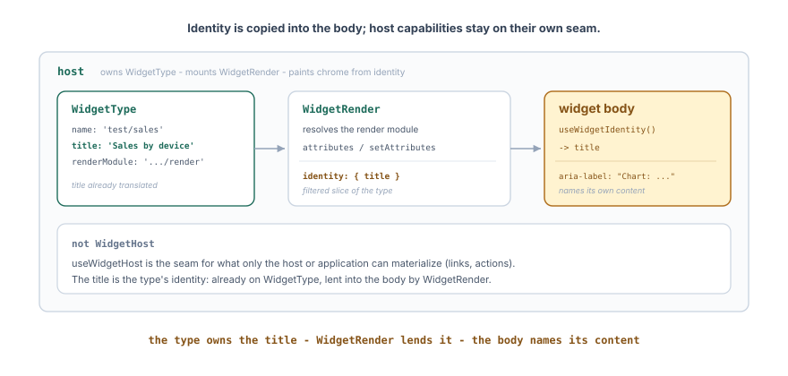

# Widget identity

<div class="callout callout-alert">
This package is still experimental. “Experimental” means this is an early implementation subject to drastic and breaking changes.
</div>

A widget type's identity — `title`, and the rest of the identity layer in **Anatomy** — lives on `WidgetType`. The host already shows it in chrome. The render body sometimes needs the same data.

`useWidgetIdentity` is how consumers read that identity consistently. A focusable chart that builds an accessible name from the title is one casual example; the hook itself only exposes identity.



## Where it sits

Alongside the other render-facing contracts:

-   Instance state: `attributes` / `setAttributes`.
-   Type identity for the body: `useWidgetIdentity`.
-   Host materialization when the widget needs it: `useWidgetHost` (`links`, `actions`). See **Widget Host**.

## Contract

```ts
type WidgetIdentity = {
	title?: string;
};
```

`title` is the translated title of the widget type, as the host already shows it. Absent identity (no provider) yields `{}`; the widget names its content itself.

The public surface is the hook and this type. The provider is an internal detail of `WidgetRender`.

## Providing it

`<WidgetRender>` already receives `widgetType`. When it mounts the render module it lends the subtree `{ title: widgetType.title }`. Any host that mounts through that entry point needs no extra wiring: the dashboard tile, its previews, and Storybook hosts that use `WidgetRender` all get it.

A host that mounts a render module directly, without `WidgetRender`, leaves identity absent and the hook returns `{}`.

## Consuming it

```tsx
const { title } = useWidgetIdentity();
const name = title
	? sprintf(
			/* translators: %s: widget title */
			__( 'Chart: %s' ),
			title
	  )
	: undefined;

return <figure aria-label={ name } />;
```

How a widget phrases a name around the title belongs to that widget and its translators. Prefer a format that does not assume word order when the locale can put the noun first; a colon-separated label is one such pattern.

Guard `title`: without a provider it is `undefined`.
